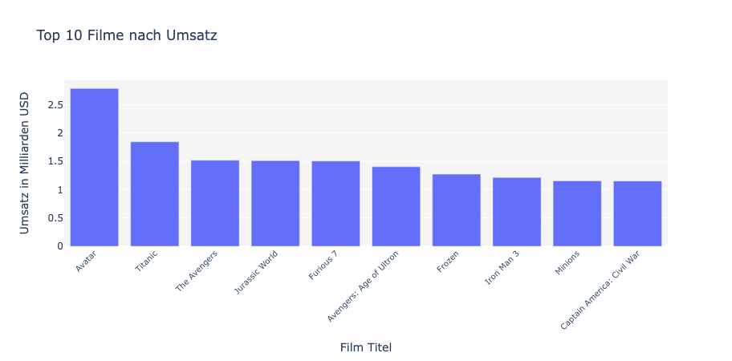
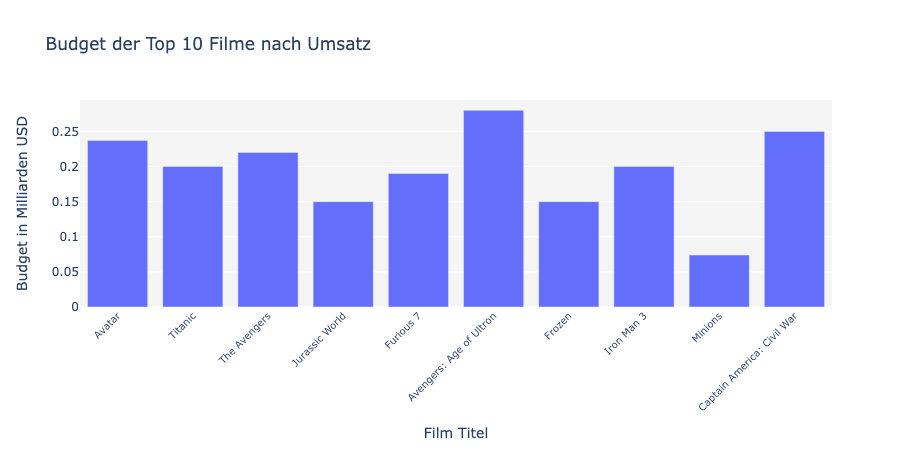
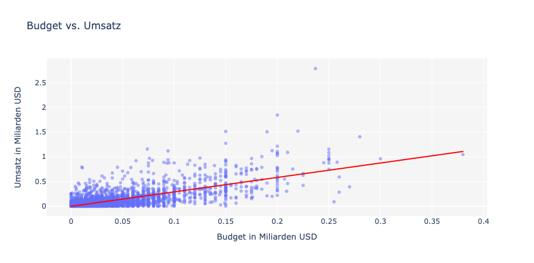
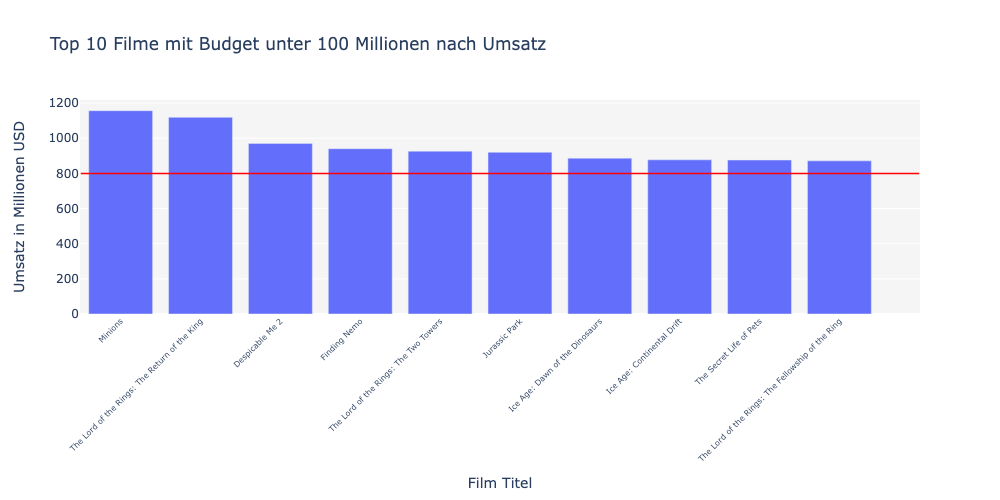
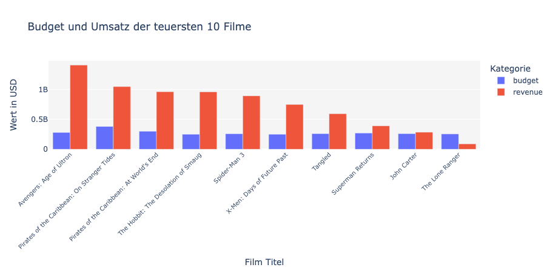
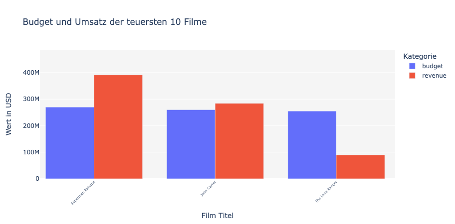

### Einleitung: Weshalb sind Filme eigentlich so teuer?

Filme und Serien sind aus unserem Leben kaum wegzudenken. Dies sieht man auch an der Anzahl verkaufter Kinotickets. Im Jahr 2022 konnten deutsche Kinos 78 Millionen Besucherinnen und Besucher verzeichnen. Doch fällt auf, dass überwiegend Filmfortsetzungen oder grosse Blockbuster in den Kinos laufen, während die eher kleineren Filme häufig direkt auf Streamingdiensten wie Netflix und Disney+ erscheinen. Könnte das daran liegen, dass es sich nicht lohnt, Filme mit wenig Budget in die Kinos zu bringen? Oder anders gefragt, muss ein Film wirklich teuer sein, um an den Kinokassen Erfolg zu haben?

Die Kosten eines Films sind massgeblich durch Faktoren wie Gehalt für die Schauspieler und Filmcrew, aufwendige Produktionstechniken sowie Marketing bestimmt. Hochbudgetierte Filme setzen oft auf spektakuläre Effekte und bekannte Stars, um ein grosses Publikum anzuziehen, während kleinere Projekte mit geringerem Budget realisiert werden.

Bedeutet das, dass Filme mit kleinem Budget, wenig Aussicht auf Erfolg haben? Dieser Frage werden wir in diesem Blogpost auf den Grund gehen.

## Sind erfolgreiche Filme immer teuer?

*Abbildung 1: Umsatz*

In der Grafik sehen wir die zehn Filme mit dem höchsten Umsatz und somit die erfolgreichsten Filme aller Zeiten. Dabei fällt auf, dass fast ausschliesslich grosse Franchises oder Blockbuster unter diesen Filmen vertreten sind. Sind dabei auch Filme, welche keine hohen Produktionskosten hatten?

*Abbildung 2: Budget*

In der Abbildung 2 sieht man die gleichen zehn Filme wie in Abbildung 1, dieses Mal aber sieht man das Budget in Milliarden USD. Es ist deutlich zu sehen, dass die Verteilung nun anders aussieht als noch in Abbildung 1, was darauf hindeuten könnte, dass der Umsatz nicht nur vom Budget eines Filmes abhängt. Jedoch sind hier immer noch sehr teure Filme dabei. Der einzige Film, der weniger als 100 Millionen USD gekostet hat und trotzdem die Marke von einer Milliarde USD Umsatz knacken konnte, ist der Film "Minions", welcher von Illumination Entertainment kreiert wurde, welches zum Universal Pictures Konzern gehört. Alle anderen Filme hatten Produktionskosten zwischen 100 Millionen USD und 300 Millionen USD.

Schauen wir uns nun eine Verteilung aller Filme der letzten 100 Jahre an.

*Abbildung 3: Lineare Regression*

Mittels einer Linearen Regression kann man den Trend in den Daten erkennen, dass Filme mit einem höheren Budget auch einen höheren Umsatz erzielen. Der Erwartungswert vom Umsatz beträgt beinahe das dreifache des Budgets. Ein Film, der also 100 Millionen USD kostet, erzielt ungefähr 300 Millionen USD an den Kinokassen.

Filmstudios könnten nach diesen Erkenntnissen der Meinung sein, dass der Schlüssel zum Erfolg in stetig wachsenden Filmkosten liegt – sei es durch die Verpflichtung grosser Hollywood-Stars oder durch den Einsatz aufwendiger und kostspieliger Computereffekten (CGI). Diese Denkweise birgt jedoch das Risiko, dass kleinere, innovative Filme zunehmend in den Schatten mächtiger Blockbuster gedrängt werden, was die Vielfalt und Kreativität der Filmbranche einschränken könnte.

## Können auch günstigere Filme erfolgreich sein?

Um dieser Frage auf den Grund zu gehen, kann man sich die Umsätze der Filme anschauen, welche weniger als 100 Millionen USD gekostet haben, und prüfen, ob es darunter auch extrem erfolgreiche Filme gibt.

In dieser Grafik sehen wir die zehn Filme mit dem höchsten Umsatz, die weniger als 100 Millionen USD Budget hatten. Man erkennt, dass auch hier extrem erfolgreiche Filme wie "Minions" oder "The Lord of the Rings: The Return of the King", dabei sind, die über eine Milliarde US-Dollar eingespielt haben. Alle zehn Filme haben jeweils mehr als 850 Millionen USD eingespielt, obwohl sie ein vergleichsweise kleines Budget zur Verfügung hatten.

Dadurch kann man erkennen, dass ein stetig wachsendes Budget für einen erfolgreichen Film **kein Muss** ist. Im Gegenteil, auch Filme mit kleinem Budget können sehr erfolgreich werden, wenn eine gute Geschichte oder auch gutes Storytelling dahinter steckt.

## Können teure Filme floppen?

Zu guter Letzt, wollen wir uns noch anschauen, ob ein teurer Film automatisch ein Erfolg sein muss. Dazu schauen wir uns eine Grafik an, in der die Umsätze und Budgets von den zehn teuersten Filmen aller Zeiten zu sehen sind.

*Abbildung 5: teuerste Filme*

In der Grafik sind die zehn teuersten Filme der Geschichte zu sehen. Die roten Balken repräsentieren den Umsatz und die blauen Balken das Budget von den Filmen. "Avengers: Age of Ultron" beispielsweise erzielte einen extrem hohen Umsatz, obwohl er nicht der teuerste Film von dieser Top-10 Liste war. Schauen wir uns die drei Filme ganz rechts etwas genauer an.

*Abbildung 6: keine Erfolge*

Man sieht, dass diese drei Filme an den Kinokassen eher schlecht performt haben. "The Lone Ranger" hat sogar weniger als die Hälfte vom Budget wieder eingespielt, was einem Verlust von über 150 Millionen USD entspricht.

Wir sehen also, dass ein Film mit einem hohen Budget nicht automatischen Erfolg verspricht.

## Fazit

Zusammenfassend lässt sich sagen, dass Filme mit hohem Budget zwar eine bessere Ausgangsposition für den Markterfolg haben, aber der Erfolg kleinerer Produktionen mit bescheidenerem Budget keineswegs ausgeschlossen ist. Oftmals sind es die Kraft einer überzeugenden Geschichte oder die Fortführung eines bereits etablierten Franchise (beispielsweise Star Wars), die wichtiger sein können als umfangreiche Finanzmittel. In der Filmindustrie ist demnach nicht allein das Budget, sondern viele weitere Faktoren wie die Wahl des Cast (Schauspieler), die Kunst eine Geschichte zu erzählen oder kreative und neue Geschichten ausschlaggebend für den Erfolg eines Films.

Für Produzenten und Filmemacher offenbaren diese Erkenntnisse eine wichtige Botschaft: Erfolg im Filmgeschäft erfordert nicht umbedingt immer höhere Ausgaben. Vielmehr kann er auch durch das Beschreiten von neuen, kreativen Wegen und das Experimentieren mit innovativen Ideen erreicht werden. Vielleicht sehen wir in Zukunft immer mehr mutige Autorinnen und Autoren welche sich an das Erfinden von ganz neuen und interessanten Geschichten trauen, anstelle von immer weiter fortlaufenden Filmreihen. Ich würde es mir wünschen.
