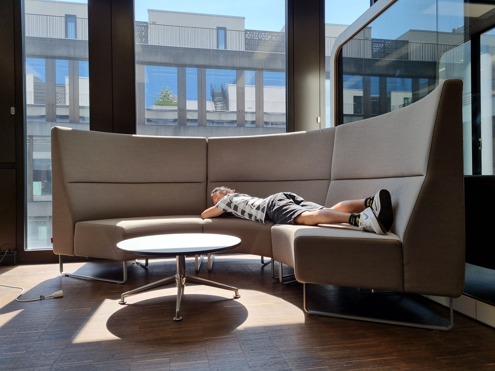
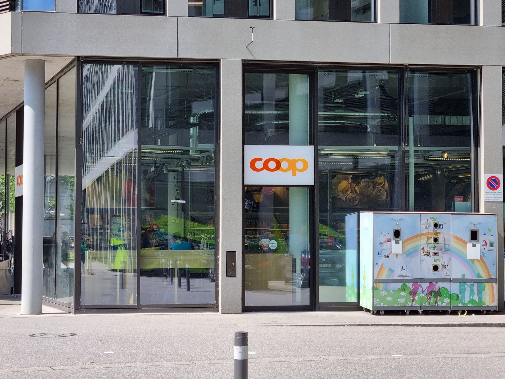

Do you find yourself constantly glued to your computer screen, consumed by the incessant digital demands of the day? Do you have a deliberate strategy for taking breaks, or are your breaks often haphazard and spontaneous? Wherever you fall on the spectrum, this blog post could be the key to a more balanced, fulfilling work experience. The key to staying productive and maintaining a sense of well-being lies in a simple yet often overlooked practice - taking a break! I urge you, even if it's just for a quick 30 seconds, to pause here and give yourself a moment of respite before you continue reading.

*by Aaron Brülisauer*

Have you? Researchers found that regular, short breaks during mentally demanding work can lead to a significant improvement in overall productivity ([Frequent short rest breaks from computer work: effects on productivity and well-being at two field sites](https://www.tandfonline.com/doi/abs/10.1080/001401397188396)). This is due to the inherent design of our brains - they are simply not built to run at full throttle all the time. To further enhance the restorative power of these breaks, experts have found that listening to uplifting music can facilitate a faster and more complete recovery ([Influence on brain activity during and after a study break using different types of music](https://pdfs.semanticscholar.org/012f/a45112922a5139601b1fa91284392738fd1a.pdf)).

This and other findings inspired me to try to improve my productivity and well-being, even though I'm in general not very open to such experiments. I had the idea to look for programs which are specifically designed to encourage users to take routine breaks, because I would have a hard time remembering taking breaks my self and found two candidates which run on my operating system: [Break Timer](https://wiki.gnome.org/Apps/BreakTimer) and [RSIBreak](https://userbase.kde.org/RSIBreak). [RSIBreak](https://userbase.kde.org/RSIBreak) blended into how my computer is setup. Just now I was remembered to take a 20-second break - I looked away from the screen, let go of the keyboard and thought about what I was going to write next. These short breaks not only refresh and invigorate the mind, but also act as an effective preventative measure against the dangers of repetitive strain injuries.

Getting used to the prescribed breaks was a challenge at first. The program required me to take a 20-second break every 10 minutes, with an additional one-minute break every hour - a schedule that felt disruptive and uncomfortable at times. I toyed with the idea of tweaking the settings to allow for less frequent but longer breaks, but ultimately decided to stick with the default settings. After a week of diligent compliance, I found myself adhering more consistently to the break regimen, despite the occasional lapse.

By the second week, a new pattern began to emerge - I noticed a tendency to reach for my phone during the prescribed breaks. This brought to light a potential shortcoming of the program - its unavailability on my mobile device. Paradoxically, using my phone during breaks led to a reduction in phone use during working hours. I reassured myself that the designated 'phone time' would come during my breaks, encouraging a more disciplined approach to my digital consumption.

Fast forward a few weeks and I found that I had largely adapted to the rhythm of the program, albeit with occasional lapses. Around the same time, a new ritual began to take root among my peers at university. Someone would propose a 'coop' and those interested would join in for a shared walk and coffee break. These shared breaks not only served as an avenue for social connection, but also fostered a creative exchange of ideas and a more effective approach to time management.

Now, two months into this journey, I still struggle with the demands of the program from time to time. However, it's undeniable that this initiative has significantly increased my awareness of my body's need for regular rest, resulting in an improved daily rhythm and more consistent sleep patterns. These regular breaks have improved my overall well-being and motivation by instilling a culture of regular rest. As a result, my non-work related screen time has also decreased significantly, with a noticeable increase in productivity and sustained motivation.

Towards the end of this semester, I decided to experiment with the program's timing settings. I adjusted the intervals to require a one-minute break every 30 minutes and a five-minute break every two hours. Admittedly, adhering to these one-minute breaks was challenging, but when I did manage to follow through, I used the opportunity to stand up, hydrate, or engage in a brief chat. Incorporating movement into these breaks seemed crucial given the sedentary nature of my day.

Looking to the future, my ideal vision is a program that is compatible across all digital devices and synchronises time spent on each platform. This would effectively prevent people from skipping breaks by switching devices. Incorporating uplifting music into breaks remains an ongoing challenge, but it's a goal I'm actively pursuing.

*https://c0.wallpaperflare.com/preview/986/764/991/girl-music-headphones-hipster.jpg*

In retrospect, my initial scepticism about a break reminder program has been completely dispelled. Not only has it increased the frequency of my breaks and improved my self-awareness, but it has also indirectly led to a number of beneficial lifestyle changes. Although it seemed like a bold idea at the outset, the experiment has yielded a number of unexpectedly positive results. The lesson is that even the most seemingly eccentric ideas can yield fruitful results, as long as they're given a fair chance. Trying something even though I really don't want to, might be something I should do more often in the future. In the end the result was worth the investment (overcome my rejection of the idea).

Reflect on your break habits. How frequent are they? How do you feel after long screen exposure? Could a tool like [RSIBreak](https://userbase.kde.org/RSIBreak) help you? If not, what alternatives might work better? Have you tried methods like music, mindfulness, or physical activity during breaks? Share your thoughts and experiences in the comments. Let's discuss this crucial topic. Remember, breaks aren't interruptions but chances to recharge. It's not about working harder but smarter. Breaks can boost productivity if you embrace them. Thanks for reading, and now, isn't it time for a break?

*by Aaron Brülisauer*

Having written down my experience, I decided to run parts of it through [ChatGPT](https://chat.openai.com/auth/login) , a sophisticated AI tool, with instructions to correct errors while preserving the original essence of the content. To ensure the quality and accuracy of the modifications, I cross-checked the output with another AI tool, [DeepL](https://www.deepl.com/write). Finally, to rule out any inadvertent distortions introduced by the AI tools, I conducted a thorough self-review of the text.
