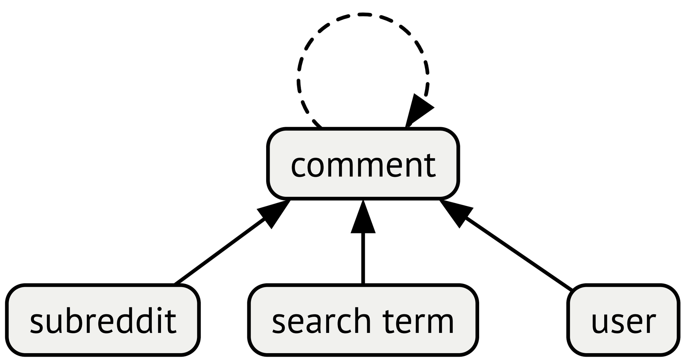
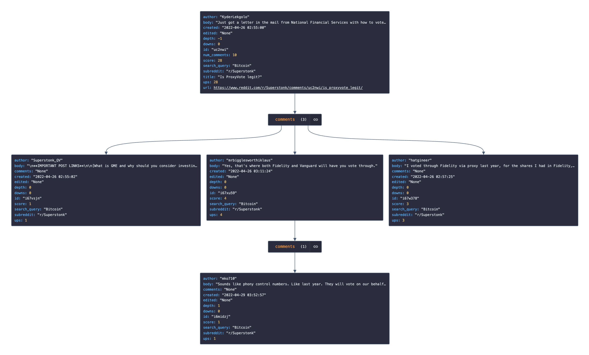
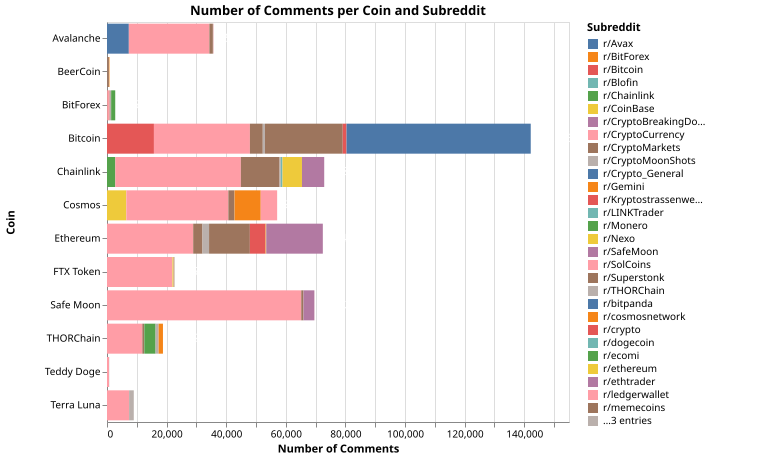
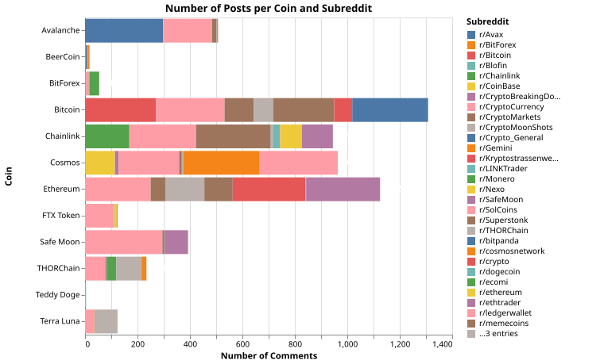
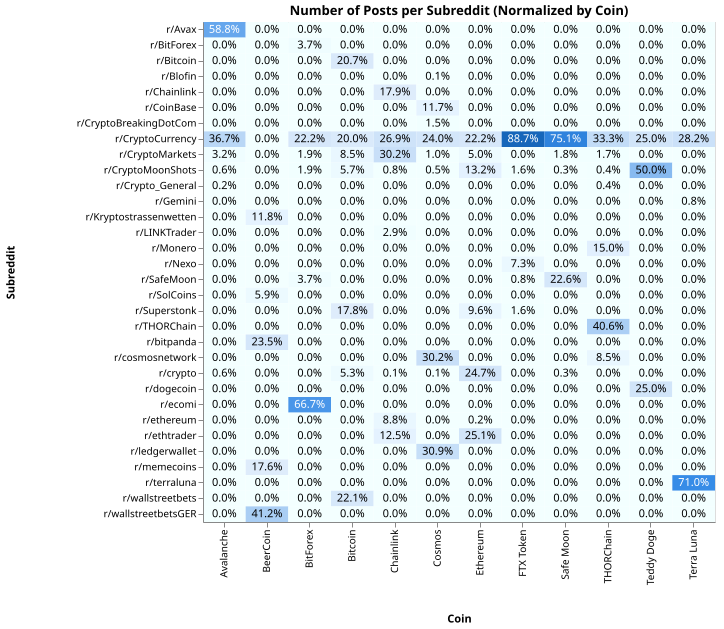
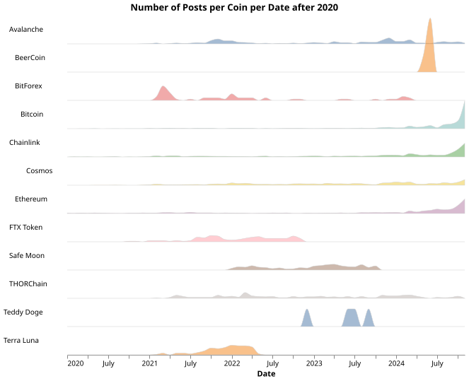

## The Importance of Fraud Detection

As cryptocurrencies and blockchain technology have emerged, the financial sector has turned its attention to this new wave. Cryptocurrencies are now widely accepted for various services. Many food chains, network providers, tech companies, and grocery stores accept crypto payments, often offering incentives to customers who use them. However, despite this success, cryptocurrencies have also enabled fraudulent schemes, leading to losses in the millions \[[SOURCE](https://www.mdpi.com/2078-2489/14/3/171)\].

According to a recent analysis by the Federal Trade Commission, consumers lost over $1 billion to cryptocurrency-related fraud between January 2021 and March 2022. The reports indicate that cryptocurrency is rapidly becoming the preferred payment method for scammers, with roughly one in every four dollars lost to fraud being paid in crypto \[[SOURCE](https://www.ftc.gov/news-events/news/press-releases/2022/06/new-analysis-finds-consumers-reported-losing-more-1-billion-cryptocurrency-scams-2021)\].

Transactions are irreversible and the anonymity of cryptocurrency can protect wrongdoers \[[SOURCE](https://www.togggle.io/blog/fraud-detection-in-crypto-essentials-for-businesses)\], making it crucial to implement fraud detection systems.

* * *

## Idea

I started the challenge by setting these two main goals:

-   Detect, if a cryptocurrency is fraudulent.
-   Evaluate and compare the effectivity of graph- and non-graph-based methods with this specific use case.

The models should be trained on scraped data. For the scraping, I joined another team, consisting of these people: Aaron Brülisauer, Can-Elian Barth and Florian Baumberger. You can see the links to their LinkedIn, GitHub and Website in the 'Acknowledgments' section.

They were interested in solving the same problem I was, but using other approaches. We wanted to scrape text data for analyzing, if we could predict if a coin was a scam using social media clues. Since it's a prediction task, we decided to use all data until the scam event, since after scam data would obviously indicate that a scam happened.

For modelling, I wanted to compare three approaches, a graph-based model (Graph Attention Network), a traditional machine learning model (Support Vector Machine) and a baseline model (Naive Bayes Classifier).

* * *

## Getting Data

The scraped data was stored in an Elasticsearch database for easy retrieval and parallelized scraping. For hosting the database, I received a Raspberry Pi 4B from Moritz Kirschmann.

For the ground truths, we explored using the "Worldwide crypto & NFT rug pulls and scams tracker" list from comparitech.com \[[LINK](https://www.comparitech.com/crypto/cryptocurrency-scams/)\]. In the end, we decided to manually pick the coins, since some coins have barely any mentions on social media. We also specified time ranges for each specific cryptocurrency, since we didn't want to scrape data about fraudulent coins after they were confirmed as fraudulent.

For the model data, we scraped data from these sources:

-   Google Search
-   𝕏 (Twitter)
-   Reddit

During scraping we noticed, that 𝕏 is hard to scrape, and that we wouldn't get reliable data. Google Search also isn't really great for graph networks, since it has a flat hierarchy and therefore edges wouldn't contain interesting information.

I then decided to prioritize the scraping of Reddit data with this structure:

*Reddit scraped graph structure.*

After we successfully implemented the Reddit scraper (with a lot of tears and sweat), we realized, that we were limited to the newest 300 posts for each search term, which would be problematic for getting pre scam data.

This is where the Google Results scraper came in handy. Using search operators \[[LIST](https://ahrefs.com/blog/google-advanced-search-operators/)\] like "filter", "before" and "after" we were able to search all the Reddit posts related to a coin in a specific time range.

In this example, we retrieve all posts related to the FTX Token on the subreddit r/CryptoCurrency between the creation of the coin and the last day before the scam was pulled off. Try it yourself by inserting the following query into the Google Search:

> FTX Token site:reddit.com/r/CryptoCurrency after:2019-08-01 before:2022-11-07

After some googling, we realized that we could simply retrieve the content of a post by adding .json to the end of the URL. The problem with this is the enormous size of the resulting .json file.

Using the "praw" Python library, we were able to filter out irrelevant data and generate a smaller .json file. For a smaller post, the structure now looks like this.

*.json file structure of a small Reddit post*

After successfully scraping the data and saving it to the Elasticsearch database, we ran some EDA. We had scraped a whopping **5'799 posts**, which totals to **504'455 individual comments**.

In the plot below, we see the distribution of the individual comments over the different coins and subreddits:

 

There seems to be a great imbalance between the number of comments per coin, which makes a lot of sense, but has to be taken into account during training.

In the plot below, we see the distribution of individual posts over the different coins and subreddits:

 

Looking at, the imbalance of posts seems to be smaller, compared to the imbalance of comments. We could interpret that as posts about smaller coins having less comments.

In the plot below, we see the percentual distribution of posts per coins and subreddits:

 

Most of the posts originate from the r/CryptoCurrency subreddit. Since this is the largest cryptocurrency subreddit \[[SOURCE](https://www.reddit.com/r/CryptoCurrency/comments/14a0m29/top_crypto_subreddits_by_size/)\], this also seems to be expected.

In the plot below, we see the normalized distribution of posts per coin over time:

 

With large coins, most of the posts are recent. This could be due to there being too many posts talking about that specific cryptocurrency and Google returning the most recent ones.

With smaller coins, we seem to have widely different distributions. If we look at the fraudulent coin "BeerCoin", all the posts are concentrated in a small timespan. Looking at the fraudulent coin "FTX Token", the posts seem to be more distributed in time.

### Train-Test split

The collected dataset now contains a lot of posts and comments, but only 11 coins. So instead of creating a train-test set where I split posts/comments (which would introduce train-test bleed), I decided to do a manual split of coins where I tried to split them stratified by all-time highest market cap and scam/non-scam classification. In the end, I ended up with 7 coins in the training set, where 4 were non-scam-coins and 3 were scam-coins and 4 coins in the test set, where 2 were non-scam-coins and the other 2 were scam-coins.

Here is an overview of the split

-   Train set
    -   Non-scam
        -   Avalanche
        -   Bitcoin
        -   Chainlink
        -   THORChain
    -   Scam
        -   BeerCoin
        -   BitForex
        -   Terra Luna
-   Test set
    -   Non-scam
        -   Cosmos
        -   Ethereum
    -   Scam
        -   Safe Moon
        -   FTX Token

* * *

## Training Methodology

I decided to do a Leave-One-Out Cross-Validation at the coin level. This means that I use all posts and comments from 6 coins to fit the model and 1 coin to evaluate performance. After that, the coin is replaced with another unused coin until every coin has been used as a validation coin. In each Cross-Validation split, all validation labels are either completely true or completely false. As a result, calculating precision or recall would involve dividing by zero, making these metrics inappropriate. Instead, I calculate only accuracy. These metrics are then used to tune the hyperparameters. Finally, I select the best hyperparameters and train the model on the entire training set using these optimized settings. The model's performance is then evaluated on the test dataset. Performance for the test data set is also evaluated on a per coin basis.

* * *

## Models

I trained three different models for comparison. My baseline model is a **Multinomial Naive Bayes Classifier** (MNB). In simple terms, this model analyzes the words in a text and calculates the probability that the text belongs to a specific class based on word frequency. It assumes that words are independent of each other given the class, making it fast and effective for structured text classification tasks.

My second model is a **Linear Support Vector Classificator** (LinearSVC). The LinearSVC is a machine learning algorithm that solves classification problems by finding the best linear hyperplane that separates data points of different classes. It works by maximizing the margin, or the distance, between the hyperplane and the closest points from each class, known as support vectors. This is done by solving an optimization problem to find the optimal coefficients for the hyperplane. LinearSVC performs well when the data is linearly separable, meaning a straight line or hyperplane can effectively separate the classes. LinearSVC is not inherently designed to work directly with text data, as it expects numerical input. However, it can be used for text classification if the text is first converted into numerical features.

My last model is a **Graph Attention Network** (GAT) \[[PAPER](https://arxiv.org/abs/1710.10903)\], which is designed for graph-structured data. It takes as input a graph, where each node has a feature vector, and the edges represent relationships between nodes. The GAT assigns attention weights to each node’s neighbors, focusing on the most relevant ones by computing attention scores based on both node features and their connections. These scores are used to weight the aggregation of neighboring nodes' features. The output is an updated feature vector for each node, which captures both the node’s own information and the important relationships in the graph. This makes the GAT particularly effective for tasks like node classification. Compared to the other two models, the GAT leverages both numerical features and relational information, therefore improving prediction. However, if there are no edges in the graph, the attention mechanism loses its purpose, as there are no neighbors to aggregate information from.

* * *

## Multinomial Naive Bayes Classifier

Since I had a lot of posts and comments but not a lot of different coins, I had to choose a different training methodology instead of just using the 11 labels. In the paper *"Do not rug on me: Zero-dimensional Scam Detection"* by Mazorra et al. \[[PAPER](http://arxiv.org/abs/2201.07220)\] they used randomly selected evaluation points per coin, so they can generate more subsets. I've decided to use the same approach.

For each coin, I randomly selected a cutoff date, ensuring that at least 50 comments were present between the start date and the cutoff. I repeated this process 50 times for each coin. Afterward, I filtered out any duplicate cutoff dates. As a result, most coins had between 45 and 50 valid subsets, with the exception of BeerCoin, which had approximately 20 valid sets.

Next, I gathered the comments for each period, from the start date to the cutoff, and concatenated them into a single large string. Finally, I used scikit-learn's CountVectorizer to transform the text into numerical features, which were then used to train the model, as detailed in the 'Training Methodology' section. Since this model was designed as a baseline, I did not put effort into optimizing the hyperparameters.

### Results

During cross-validation on the training set, the model correctly identified non-scam coins as non-scam. However, it misclassified the BitForex and Terra Luna tokens as non-scam as well. The exception was BeerCoin, which the model correctly classified as a scam in 80% of the subsets. When validated on the test set, the model exhibited the same issue, predominantly classifying all coins as non-scam.

* * *

## Linear Support Vector Classificator

Since the baseline performed poorly with the evaluation point method, I decided to label each comment based on its respective coin’s label and train the model using each comment as an individual data point. This approach aimed to provide a more accurate percentage rating rather than a simple true/false classification. Additionally, I used the BertTokenizer and BertModel from the Hugging Face's Transformers library to tokenize the comments and convert them into numerical features, resulting in a numerical representation of the text.

Since the LinearSVC model was very slow due to the large volume of data, I switched to the implementation provided by the cuML RAPIDS library. This version is an optimized GPU-accelerated implementation of the sklearn method, designed to run efficiently on NVIDIA GPUs.

### Results

During hyperparameter optimization, the best configuration correctly identified all non-scam coins and two out of the three scam coins. The exception was Terra Luna, which the model predicted as non-scam. Most predictions were very close to the decision boundary of 50%. For instance, with THORChain, the model was only 50.7% confident that the coin wasn’t a scam. When validated on the test set, the model correctly identified the non-scam tokens as non-scam but incorrectly classified the scam tokens as non-scam. This model does not appear to outperform the baseline in terms of results.

* * *

## Graph Attention Network

For the Graph Attention Network (GAT), I used the same BERT embeddings as in the LinearSVC model. To enhance the input, I appended the normalized score \[0; 1\] of each comment to the start of the embedding vector.

The GAT implementation leverages the PyTorch Geometric library and uses the following key parameters:

-   in\_channels: Always set to 769 (768 for the embedding vector and 1 for the normalized score).
-   out\_channels: Specifies the output size; when set, a linear layer is added after the GATConv layers. I configured it to 1 for binary classification, passing the resulting scalar through a sigmoid function.
-   hidden\_channels: Controls the size of the hidden feature vectors.
-   num\_layers: Sets the number of GAT layers in the model.

The number of attention heads defaults to 1, as the library does not provide an option to configure this parameter.

For graph generation, I initially aimed to model relationships between comments by the same user, comments in the same subreddit, and parent/child comment relationships. However, this approach generated over 100 million edges, exceeding the 32 GB of RAM on my system. To address this, I simplified the graph to include only edges between each comment and its parent/child comments.

### Results

In the initial attempt, I included all nodes in the graph, but this led to the model classifying nearly everything as non-scam due to the significant class imbalance. To address this issue, I tried random sampling of comments to balance the classes in the second attempt. While this improved the class distribution, most of the edges in the graph disappeared, meaning the GAT could no longer leverage relationships effectively, making even an MLP a more suitable choice for this scenario.

In the third attempt, I sampled comments on a per-post basis, which yielded better results as it could now leverage the relationships between comments. I compared this approach to the second one using a custom metric based on the F1 score. The metric uses the mean accuracy for all the coins that are not labeled as scams and the mean accuracy for all the coins that are labeled as scams. This formula penalizes low accuracy values for each label, ensuring a more balanced evaluation of the model's performance across both classes.

The third approach performed slightly better. The best score I achieved with the second approach was around 0.472, while the best score of the third approach returned a score of around 0.509. The three best scores from the third approach were slightly better than the best score from the second approach, but the difference was not substantial and could have simply been due to random variation.

Given that the approach did not perform well even on the validation data, I decided not to proceed with testing on the test dataset.

* * *

## Discussion

Although my models produced varying results, none were able to reliably classify coins as either scams or legitimate. I suspect that simply analyzing Reddit comments prior to a scam doesn't provide sufficient information to make a reliable prediction. Furthermore, our dataset, despite containing a large number of comments for bigger coins, lacks enough data for smaller coins, which limits the diversity necessary for accurate training. With such a small sample size and a limited variety of coins, the models potentially struggle to identify the specific patterns that would signal a potential scam. Another possible explanation could be that the BERT embeddings used are not adequately capturing the relevant features in the comments. To improve the models, it may be necessary to fine-tune the embeddings specifically for fraud detection tasks.

Additionally, approaches like the Graph Attention Network could potentially perform better if there were a more suitable dataset with richer relationships between entities, such as comments, users, and posts. In my attempt to model the relationships between comments from the same user and comments within the same subreddit, hardware limitations forced me to compromise by only modeling the relationships between individual comments. With access to more computing power, it may be possible to expand the scope of these relationships, enabling the model to better capture the nuances in how users and posts interact. This could lead to improved performance, as the graph structure would have more meaningful connections to leverage.

It would also be interesting to integrate price data for the coins or data from other sources, such as transaction volumes, to enhance the model's predictive capabilities. Incorporating these additional features could provide a more comprehensive view of each coin's behavior and improve the accuracy of the predictions.

* * *

## Personal reflection

Tackling this problem was a rewarding experience, though I underestimated the time required for data scraping. The scraping process, while ultimately elegant and straightforward, involved a lot of trial and error and ended up consuming more than half of the available project time. In hindsight, starting with a pre-existing dataset would have allowed me to focus more on modeling and evaluation.

Despite the challenges, I’m proud of the results, especially considering that the implementation, training, and evaluation of the models became more time-intensive as I worked alone on that part, following my earlier collaboration on planning the data strategy and scraping the data. I successfully explored all the planned approaches, even if I couldn’t analyze everything as deeply as I had hoped. This experience highlighted the importance of data quality and the limitations of computational resources in complex projects.

I also had my first hands-on experience with Graph Attention Networks. Initially, I thought they would be difficult to understand and implement, but I found them surprisingly intuitive. Building and training the model turned out to be less complex than I anticipated. Moving forward, I’m excited to apply GATs to future projects, especially those involving graph data with meaningful connections. Their ability to capture relationships between entities has a lot of potential, and I look forward to exploring it further.

* * *

## Acknowledgments

I would like to thank my supervisors for their guidance and assistance.

-   Michael Henninger \[[LINKEDIN](https://www.linkedin.com/in/michael-henninger/)\]\[[WEBSITE](https://www.fhnw.ch/de/personen/michael-henninger)\]
-   Stephan Heule \[[LINKEDIN](https://www.linkedin.com/in/stephanheule/)\]\[[WEBSITE](https://www.fhnw.ch/de/personen/stephan-heule)\]
-   Moritz Kirschmann \[[LINKEDIN](https://www.linkedin.com/in/moritz-kirschmann/)\]
-   Adrian Brändli \[[LINKEDIN](https://www.linkedin.com/in/adrian-br%C3%A4ndli-32921ba6/)\]\[[WEBSITE](https://www.fhnw.ch/de/personen/adrian-braendli)\]

And thanks to these guys for collaborating with me on the data acquisition part.😇  
(Sorry Can-Elian for my 36 comments on your pull request)

-   Aaron Brülisauer \[[LINKEDIN](https://linkedin.com/in/aaron-brülisauer-193008279)\]\[[GITHUB](https://github.com/nod0n)\]\[[WEBSITE](https://nod0n.github.io)\]
-   Can-Elian Barth \[[GITHUB](https://github.com/can020202)\]\[[WEBSITE](https://can020202.github.io/)\]
-   Florian Baumberger \[[LINKEDIN](https://www.linkedin.com/in/florian-baumgartner-17a014210/)\]\[[GITHUB](https://github.com/FloBaumgartner)\]\[[WEBSITE](https://flobaumgartner.github.io)\]

* * *

## Links

-   The GitHub repository with all the scrips and source code: \[[LINK](https://github.com/CryptoFraudDetection/cgml)\]
-   The dataset without the BERT embeddings: \[[LINK](https://chk.me/8H1erm8)\]
-   The dataset with the BERT embeddings: \[[LINK](https://chk.me/Kux8JTc)\]
-   An interesting video regarding this topic: \[[LINK](https://youtu.be/dQw4w9WgXcQ)\]
