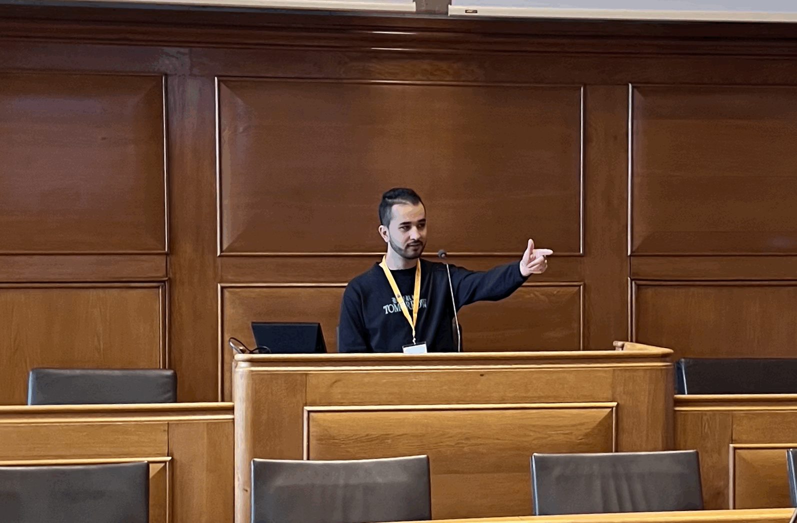
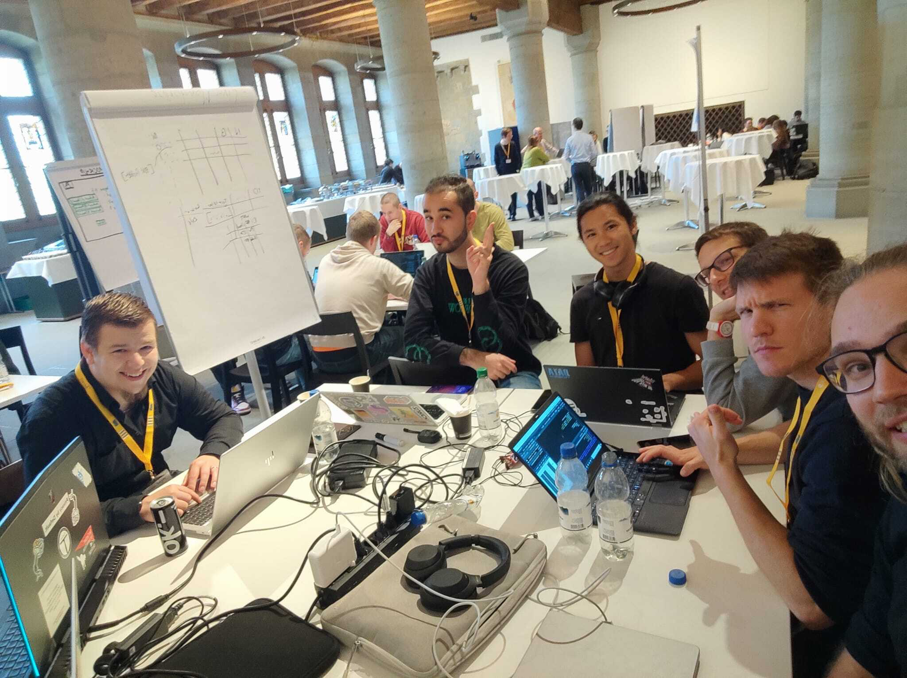
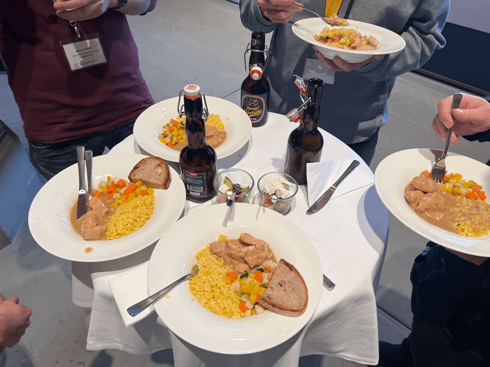
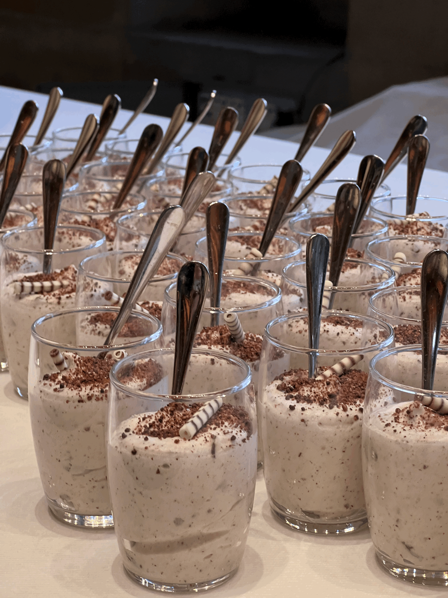
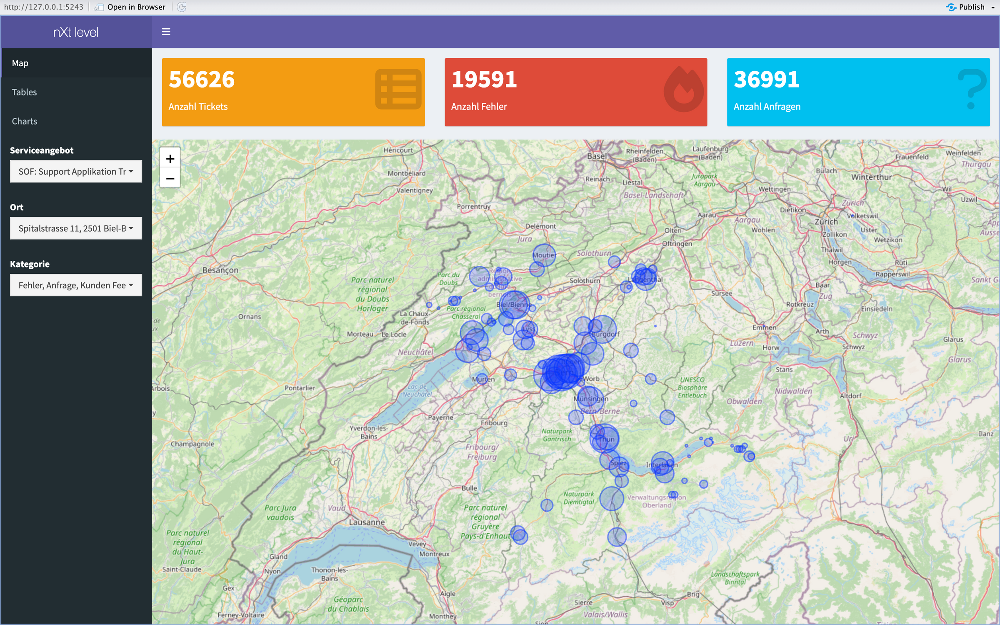
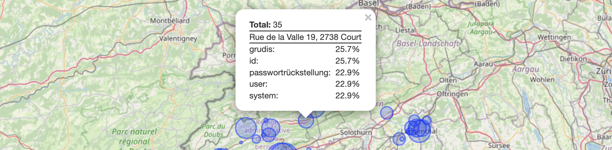
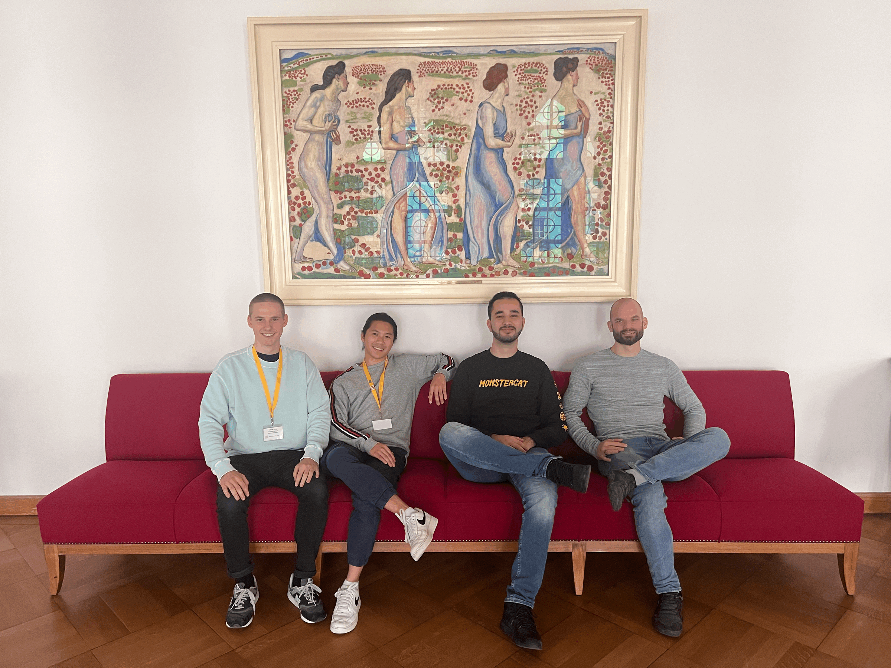

[#DataHackdaysBE](https://twitter.com/hashtag/DataHackdaysBE?src=hashtag_click)

## Partizipative Veranstaltung?

Im Rahmen meines Kompetenzerwerbs "Partizipative Veranstaltungen durchführen" an der Fachhochschule Nordwestschweiz musste ich an einem partizipativen Format teilnehmen. Aber was genau versteht man unter einem partizipativen Format?

> Partizipative Formate wie Hackathons, Design Thinking-Workshops und Open-Source-Communitys sind Veranstaltungen oder Diskussionen, bei denen die Teilnehmer aktiv mitwirken und gemeinsam Entscheidungen treffen. Sie schaffen eine dynamische Atmosphäre, die Zusammenarbeit, Dialog und Engagement fördert, indem sie die Meinungen und Ideen der Teilnehmer einbeziehen.  
>   
> Im technischen Umfeld sind besonders Hackathons herausragende Beispiele für solche partizipativen Formate und eine beliebte Art von Veranstaltungen. Sie zeichnen sich durch ihre intensive und konzentrierte Arbeitsatmosphäre aus, in der Teilnehmer mit Hingabe an technischen Herausforderungen arbeiten. Hackathons bieten die Möglichkeit, innerhalb eines begrenzten Zeitrahmens an konkreten Projekten zu arbeiten und Ergebnisse in kurzer Zeit zu erzielen. Diese Kombination aus Zeitdruck, Fokus und gemeinsamer Zielsetzung macht Hackathons attraktiv für Menschen, die ihre Fähigkeiten unter Beweis stellen und innovative Lösungen entwickeln möchten.  
>   
> \- (ChatGPT, persönliche Kommunikation, 24. Mai 2023)

Gemeinsam mit einigen Kommilitonen habe ich mich dafür entschieden, an einem Hackathon teilzunehmen. Da ich ein grosser Fan von öffentlichen Daten bin, habe ich mich für die Veranstaltung "Data Hackdays BE 2023" entschieden, die von OpenData.ch organisiert wurde und im Berner Rathaus stattfand. Meine Erwartung war es, meine im Studium gewonnenen Erkenntnisse in einer spannenden Challenge anzuwenden, um Lösungsansätze für zukünftige Optimierungen von öffentlichen Problemstellungen zu entwickeln.

## Data Hackdays

Am ersten Tag trafen wir uns um 8 Uhr in Bern. Das Rathaus befand sich etwa 15 Minuten vom Bahnhof entfernt. Am Rathaus wurden wir herzlich mit einem Brunch empfangen. Anschliessend wurden uns im Grossratssaal die Challenges präsentiert. Ich hatte die Ehre, den Platz des Grossratspräsidenten einzunehmen. 😎

  
Nach den Challenge-Präsentationen haben wir uns in zwei Gruppen aufgeteilt, um neue Leute kennenzulernen und Vielfalt in unsere Gruppe zu bringen. Ben und ich entschieden uns für die Challenge "Next Level". In dieser Challenge ging es darum, aus den entstandenen Datenmengen im First und Second Level Support einen Mehrwert zu generieren. Obwohl heutzutage viele Issues und Service Requests erfasst werden, bleiben die Freitextfelder wie Problembeschreibung und Lösungsbeschrieb oft nur zur Dokumentation ausgefüllt. Unser Ziel war es, die wichtigen Informationen aus diesen Freitextfeldern zu identifizieren und sie in den Analyseprozess einzubeziehen.

Unsere Gruppe war äusserst divers und setzte sich aus Medieninformatikern, Wirtschaftsinformatikern, Statistikern, Psychologen, First Level Supportern und Data Scientists zusammen.

Bevor wir aber viel machen konnten war bereits Mittag. Das Mittagessen wurde uns von den Orgsanisatoren bereitgestellt. Leider haben wir kein Bild davon gemacht. 😭

Nach dem Mittag gings wieder los: Ein Teil der Gruppe widmete sich dem Requirements Engineering, während der andere Teil die erste Datenanalyse durchführte. Die erfassten Tickets enthielten kategorische Spalten, die einfache, aber ungenaue Datenanalysen ermöglichten. Da unser Challenge-Owner bereits ein Tool dafür hatte, beschlossen wir, die Freitextspalten der Tickets zur Erkennung von Trends zu nutzen, da dies von grösserem Nutzen wäre. Unser Ziel war es, locationbasierte Wordclouds zu generieren, die die wichtigsten Schlüsselwörter aus den Texten als Datenquelle verwenden. Um die Schlüsselwörter zu bestimmen, wollten unsere Teammitglieder die am häufigsten genannten Wörter verwenden. Dabei bestand jedoch die Gefahr, dass unwichtige Wörter wie Artikel, Pronomen, Präpositionen und Konjunktionen einbezogen würden. Hier kam unser Wissen als Data Scientists ins Spiel. In der Dokumentenverarbeitung wird das TF-IDF (Term Frequency-Inverse Document Frequency) Mass verwendet, um die wichtigsten Wörter zu bestimmen:

> *TF-IDF ist ein statistisches Mass, welches die Relevanz eines Begriffs in einem Dokument misst. Es kombiniert die Häufigkeit des Begriffs im Dokument (TF) mit seiner Seltenheit in der gesamten Dokumentsammlung (IDF). Hohe TF-IDF-Werte weisen auf bedeutungsvolle und einzigartige Begriffe hin.*  
>   
> \- (ChatGPT, persönliche Kommunikation, 15. Mai 2023)

Mit diesem Mass konnten wir nun die 10 wichtigsten Keywords zu jedem Ticket extrahieren. Mit diesen Informationen haben wir angefangen, ein Dashboard zu entwickeln. Wir wollten ein Kartenbasiertes Dashboard erstellen, auf welchem man eine Location auswählen konnte und dort die 5 wichtigsten Keywords der Tickets sehen konnte. Dieses soll auch nach Serviceangebot und Kategorie filterbar sein.

Die Stunden vergingen schnell… etwas zu schnell! Es war bereits Abend und wir bekamen unser Abendessen.

Nach dem Abendessen haben wir noch etwas weitergearbeitet, jedoch war es langsam an der Zeit, den Heimweg zu bestreiten. Wir waren alle sehr müde und konnten es kaum erwarten, wieder im Bett zu liegen. Ich hatte in der vorherigen Nacht nur 4 Stunden Schlaf und wollte deswegen jede mögliche Minute ununterbrochen dem Schlafen widmen. 😴

Am nächsten Tag kamen wir ausgeschlafen wieder um 8 Uhr in Bern an. Voller Motivation gingen meine Teamkameraden und ich wieder an die harte Arbeit. Ich habe mich mit der Datenpipeline auseinander gesetzt: Da unterschiedliche Personen an der Datenpipeline gearbeitet haben, hatten wir verschiedene Jupyter Notebooks, welche unorganisiert waren und in keiner Reihenfolge bestanden. Mein Ziel bis zum Mittag war es, alle Fehler und Imperfektionen der Pipeline zu beheben, die Pipeline in einem Jupyter Notebook zusammenzuführen und den Code so zu dokumentieren, dass ein externer Entwickler den Code ohne Probleme nachvollziehen kann. Dies hat mir einige Stunden Aufwand zubereitet und meine Lebenserwartung stark verkürzt. Jedoch konnte ich vor dem Mittagessen meinen Teamkameraden einen sauberen und definitiven Datensatz liefern.

Leider waren Lukas und Ben dieses Mal nicht sehr zufrieden mit dem Mittagessen. Ich war aber positiv davon überzeugt. En gueteeee!

Nach dem Mittag hatte die ganze Gruppe das gleiche Ziel: Wir müssen unser Dashboard aufpeppen und eine coole Präsentation liefern! Ich habe mich bei der Weiterentwicklung des Dashboards beteiligt. Bei der Entwicklung des Dashboards entstanden sehr viele Mergekonflikte. Da ich mich gut mit GIT auskannte und wusste, wieso diese Konflikte entstehen und wie man diese löst, konnte ich meine Teamkameraden dabei unterstützen. Als letztes habe ich noch den Task bekommen, das Dashboard visuell zu verschönern. Dies habe ich dann mit der Wahl von Icons und richtiger Farben erreicht.

Nach viel Arbeit und Leidenschaft von meiner Gruppe war unser Dashboard fertig. So sieht es aus:

Auf der linken Seite sehen wir alle Pages und Filtereinstellungen. Wir haben auf der Hauptansicht oben simple Aggregationen zu den Tickets. Auf der Map selbst sind Kreise zu erkennen. Diese Kreise zeigen die Standorte der Tickets an. Desto mehr Tickets an einem Standort entstanden sind, desto grösser sind die Kreise.

Wenn man eines dieser Kreise selektiert, sieht man die meistverwendeten Keywords dieses Standorts. Hier gibt es zum Beispiel viele Probleme mit dem Tool grudis und es gibt regelmässig Passwortrückstellungen. In den Views "Tables" und "Charts" haben wir eine Tabellenansicht und einige Charts dazu. Diese dürfen wir aber nicht zeigen, da diese Daten nicht öffentlich sind.

Durch die Nutzung dieses Dashboards kann der Service Desk Manager frühzeitig Trends und Muster in Bezug auf die Tools erkennen. Die Visualisierungen ermöglichen eine schnellere und intuitivere Analyse der Ticketdaten, um Probleme oder häufig auftretende Anfragen besser zu verstehen und entsprechende Massnahmen zu ergreifen.

Als letztes haben wir dann unsere Ergebnisse präsentiert. Die Präsentation lief leider nicht so wie ich sie erhofft habe, jedoch habe ich mich gefreut, dass wir unsere Ergebnisse vor dem grossen Publikum präsentieren konnten.

Nach den Präsentation haben sich die Data Scientists versammelt noch einige schöne Bilder, wie zum Beispiel dieses, geschossen. 🥳

Am Schluss wurden wir noch mit einem Apero überrascht und wurden daraufhin entlassen.

Dank der engagierten Unterstützung und Zusammenarbeit unseres Teams haben wir unsere Ziele in einer anspruchsvollen und arbeitsreichen Zeit erreicht. Herzlichen Dank an euch alle für euren Einsatz und die hervorragende Arbeit!

## Reflexion

### Wie partizipativ war die von mir besuchte Veranstaltung?

Die Data Hackdays BE 2023 waren eine äusserst partizipative Veranstaltung, die eine intensive Zusammenarbeit zwischen den Teilnehmern ermöglichte. Von Anfang an hatten wir die Möglichkeit, uns in Gruppen aufzuteilen und neue Kontakte zu knüpfen. Dadurch konnten wir eine vielfältige Mischung von Perspektiven in unsere Gruppe einbringen. Die Teilnehmer hatten die Möglichkeit, gemeinsam über die Herausforderung zu entscheiden, die ihren individuellen Interessen und Fähigkeiten am besten entsprach.

### Was ist dort gut gelungen und was könnten die Veranstalter/ich ändern, damit ein fundierter Austausch und ein Miteinander noch besser gelingt?

Die Hackathon-Veranstaltung war insgesamt gut organisiert und durchgeführt. Die Veranstalter haben sich grosse Mühe gegeben, eine inspirierende und angenehme Umgebung zu schaffen. Es gab eine beeindruckende Vielfalt an Herausforderungen, die uns motiviert und herausgefordert haben. Das Catering mit Brunch, Lunch und Dinner hat dazu beigetragen, dass die Stimmung gut war und wir uns voll auf unsere Aufgaben konzentrieren konnten. Zusätzlich wurden soziale Aktivitäten wie ein abschliessender Apéro organisiert, um sich auszutauschen und zu vernetzen.

Natürlich gibt es immer Raum für Verbesserungen. Eine grosszügigere Zeiteinteilung für die Teilnehmer würde helfen, den Stress zu reduzieren, dem wir oft ausgesetzt waren. Kleinere Ziele könnten den Teilnehmern helfen, ihre Aufgaben effektiver zu erledigen. Es ist aber wichtig anzumerken, dass solche Herausforderungen typisch für die Hackathon-Erfahrung sind.

### Was habe ich ganz persönlich bezüglich Partizipation erfahren und gelernt?

Während des Hackathons habe ich persönlich erfahren, wie sinnvoll es war, diese Veranstaltung als Hackathon anzubieten. Durch die intensive Arbeitsweise innerhalb eines begrenzten Zeitrahmens konnten wir unsere Kreativität und Problemlösungsfähigkeiten auf ein neues Level bringen. Der Hackathon bot uns die Möglichkeit, uns intensiv mit einer spezifischen Herausforderung auseinanderzusetzen und gemeinsam Lösungen zu entwickeln. Durch diese fokussierte Arbeitsweise konnten wir schnell Fortschritte erzielen und unsere Ideen in kurzer Zeit umsetzen.

Zudem ermöglichte der Hackathon eine effektive Partizipation aller Teilnehmer. Jeder hatte die Chance, seine individuellen Fähigkeiten und Perspektiven einzubringen und aktiv am gemeinsamen Projekt zu arbeiten. Die Atmosphäre war von Teamgeist und Zusammenarbeit geprägt, da wir uns gegenseitig unterstützten und unsere Stärken optimal nutzen konnten.

Insgesamt hat der Hackathon als Veranstaltungsformat eine sehr positive Wirkung auf mein Verständnis von Partizipation gehabt. Es hat mir gezeigt, dass effektive Partizipation nicht nur bedeutet, gehört zu werden, sondern auch aktiv an gemeinsamen Projekten teilzuhaben und Ergebnisse gemeinsam zu erarbeiten.

Ein Bereich, den ich persönlich verbessern könnte, ist die Ergebnispräsentation. Obwohl mein Team und ich hart an unserem Dashboard gearbeitet haben, war die Präsentation nicht so erfolgreich wie erhofft. Zukünftig würde ich mich stärker bemühen, meine Teammitglieder, die an der Präsentation arbeiten, einzubeziehen und meine eigene Meinung zur Präsentation einzubringen.

### Fazit

Die Data Hackdays BE 2023 waren ein sehr wertvolles Erlebnis. Ich habe nicht nur meine technischen Fähigkeiten verbessert, sondern auch gelernt, effektiv partizipativ zusammenzuarbeiten. Die Veranstaltung hat gezeigt, wie Partizipation Innovation, Kreativität und Zusammenarbeit fördern kann. Ich schätze diese Erfahrung sehr und werde die erworbenen Kenntnisse in mein Studium und mein Berufsleben einbringen. Dank der hervorragenden Organisation und des Engagements der Veranstalter waren es intensive und produktive Tage!
