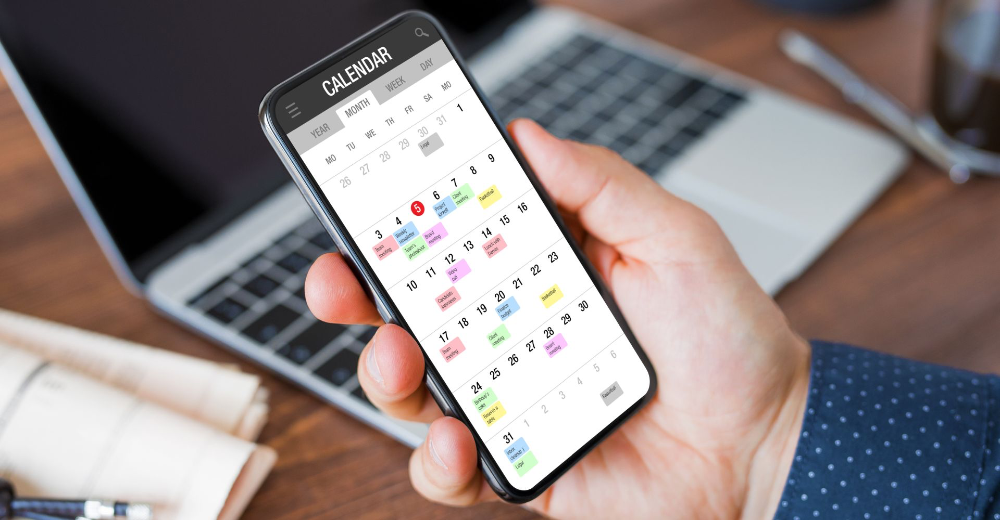
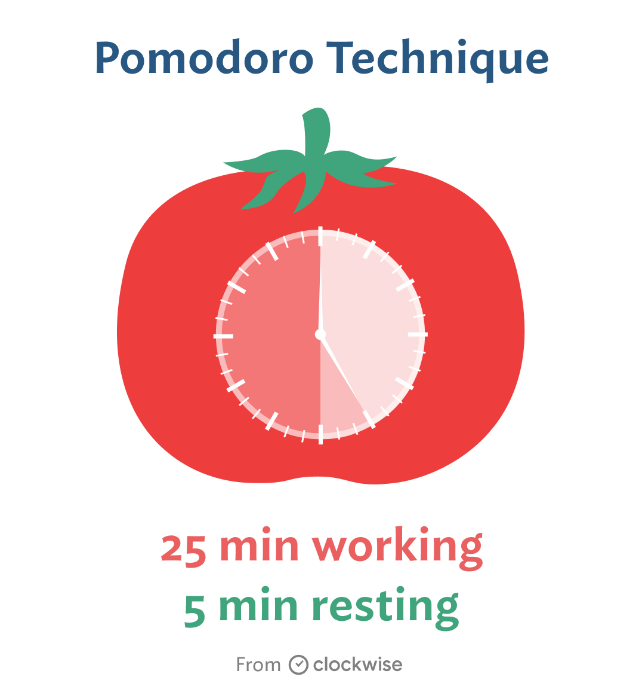
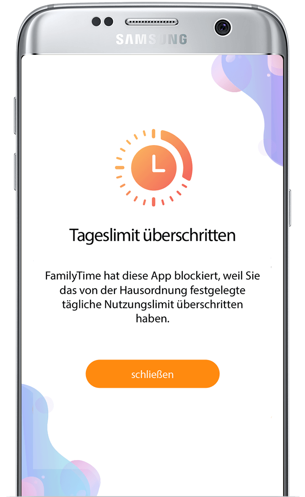
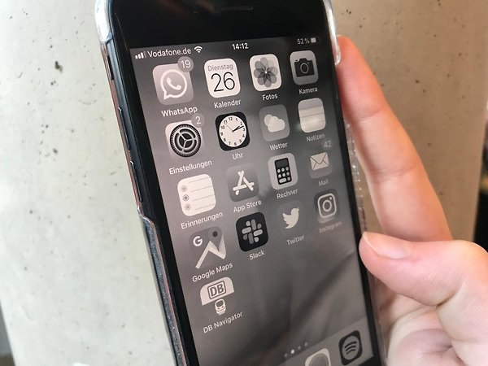
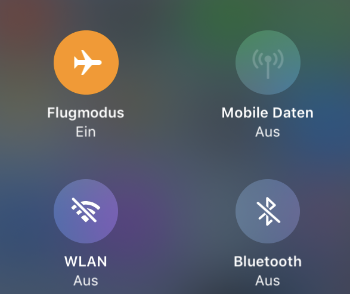

Ein Blog von Lukas Zemp, BSc Student in Data Science an der Fachhochschule Nordwestschweiz in Brugg/Windisch

## Das Problem mit dem Smartphone!

Jede Studentin, jeder Student kennt das Problem. Man hat noch viele Prüfungen und Abgaben vor sich, die man erledigen muss oder man will einfach nur effizient arbeiten können. Trotzdem kommt man einfach zu nichts. In vielen Fällen ist diese Faulheit oder Unproduktivität auf die Nutzung des Smartphones zurückzuführen. Man wird Tag und Nacht abgelenkt und ist unkonzentriert. Oft reicht die Sucht nach dem Handy soweit, dass man wichtige Abgaben verpasst oder schlechte Noten erhält, weil man zu wenig lernt. In diesem Blog möchte ich euch meine Tipps und Tricks mit auf den Weg geben, wie ihr effektiv verhindern könnt, ständig vom Smartphone abgelenkt zu werden und somit mehr Zeit zum lernen habt.

## Wie bin ich vorgegangen?

Ich habe während sechs Wochen in einem Selbstexperiment sechs verschiedene Methoden getestet, die mich davon abhalten sollten, während dem Lernen ans Handy zu gehen. Einige haben dabei besser funktioniert als andere. Um die Wirkung von den Tipps festzustellen, habe ich mir eine Excel Tabelle erstellt mit allen Tricks und den Tagen, an denen ich diese Tricks angewendet habe. Jedesmal, wenn ich mich von meinem Handy ablenken lassen habe, notierte ich dies in der Tabelle und markierte, wie lange ich dabei vom Handy abgelenkt wurde. Am Ende der Woche, sah ich dann jeweils effektiv, wie viel Zeit ich während dem Lernen am Handy verschwendet habe.

In den folgenden Kapiteln zeige ich euch meine getesteten Methoden auf und erkläre ob diese für mich funktioniert haben und welches meine persönliche Lieblingsmethode ist.

## Woche 1: Handy Zeit im Kalender eintragen!

In der Woche 1 habe ich mir jeweils am Abend die Handyzeit für den nächsten Tag in meiner Kalender APP eingetragen. So habe ich mir beispielsweise vorgenommen von 08:00 – 09:00 Uhr zu lernen damit ich danach 10 Minuten am Handy sein darf (und so weiter). Leider kam heraus, dass ich mich dadurch überhaupt nicht abhalten lies, mich am Smartphone zu beschäftigen. In dieser Woche habe ich mich ganze 100 Mal von meinem Handy ablenken lassen und insgesamt ganze 450 Minuten Lernzeit verschwendet. Das entspricht 7.5 Stunden, also fast einem ganzen Arbeitstag. Diese Methode hat bei mir also nicht wirklich gut geklappt. Daher gehen wir gleich weiter zu dem nächsten Trick.

## Woche 2: Fokus Timer “Flow” benutzen!

In der zweiten Woche habe ich versucht, mit der Pomodoro Methode1  weniger Zeit am Smartphone zu verbringen. Dazu habe ich die APP “Flow”2 im Appstore heruntergeladen. In der App kann man sich unterschiedlich lange Timer einstellen. Dabei habe ich mich an die Pomodoro Technik gehalten. Diese besagt, dass man 25 Minuten fokusiert arbeiten soll und danach 5 Minuten Pause macht. Wenn man diesen Ablauf vier Mal durchgemacht hat, darf man sich eine längere Pause von 20 – 30 Minuten gönnen. Da man jeweils nur kleine Blöcke von 25 Minuten konzentriert bleiben muss, ist man viel motivierter und kann in dieser Zeit gut auf das Handy verzichten. Mit Hilfe dieser App, konnte ich viel besser und konzentrierter lernen. Ich habe mich zwar immernoch ca. 70 Mal vom Smartphone ablenken lassen, jedoch immer nur sehr kurz. Insgesamt habe ich mich in dieser Woche “nur” 1.2 Stunden von meinem Handy vom Lernen abbringen lassen.

## Woche 3: App-Begrenzung für Social Media einrichten!

Auf allen Android Geräten und auch auf den Iphones kann man für jedes Beliebige App eine App-Begrenzung einrichten. Android: [https://androidmag.de/tipps/system-tipps-nutzungsdauer-von-apps-beschraenken/](https://androidmag.de/tipps/system-tipps-nutzungsdauer-von-apps-beschraenken/) , Apple: [https://support.apple.com/de-ch/guide/iphone/iphbfa595995/ios](https://support.apple.com/de-ch/guide/iphone/iphbfa595995/ios). Wenn man also an einem Tag zu lange auf einer bestimmten App ist, wird diese vom Handy automatisch blockiert. Diese Methode wollte ich umbedingt testen und war mir sicher, dass es gut funktionieren wird. Für mich persönlich, war dieses Tool jedoch nicht sehr hilfreich, da ich dann eifach immer die App-Blockade aufgehoben habe und trotzdem am Handy war. In der Woche lenkte mich mein Handy 110 Mal ab, was einer Dauer von fast 7 Stunden entsprach.

## Woche 4: Smartphone in den Schwarz/Weiss Modus setzen!

Die modernen Smartphones haben fast alle einen Schwarz/Weiss Modus. Bei meinen Recherchen, habe ich gelesen, dass durch den Schwarz/Weiss Modus viel weniger Dopamin in unserem Gehirn ausgeschüttet wird.2 Dies führt dazu, dass wir automatisch weniger am Handy sein wollen und wir uns nicht von den roten Benachrichtigungssymbolen ablenken lassen. Das ist ein extrem spannendes Thema. Wer sich genauer darüber informieren will, kann gerne auf die Folgende Seite gehen. [https://www.ksta.de/ratgeber/digital/einfacher-trick-so-lassen-sie-sich-nicht-mehr-staendig-von-ihrem-smartphone-ablenken-32104558?cb=1653583194552&](https://www.ksta.de/ratgeber/digital/einfacher-trick-so-lassen-sie-sich-nicht-mehr-staendig-von-ihrem-smartphone-ablenken-32104558?cb=1653583194552&) Ich habe den Filter jeweils zu den Lernzeiten aktiviert und muss sagen, dass es bei mir sehr gut funktioniert hat. Ich habe mich zwar nicht viel weniger vom Handy ablenken lassen, dafür immer nur ganz kurz. Es hat mir also einfach nicht so viel Spass gemacht am Handy und auf Instagram zu sein, da alles so langweilig schwarz/weiss war. In der Woche habe ich ca. 87 Mal aufs Smartphone geschaut, aber insgesamt nur knapp 2 Stunden.

## Woche 5: Smartphone in den Flugmodus setzen!

Um während den Lernphasen keine lästigen Anrufe oder SMS zu erhalten, wollte ich versuchen, ob ich mit Hilfe von dem Flugmodus konzentrierter lernen kann. Leider stellte sich diese Methode sehr schnell als grosser Flop heraus! Das Problem dabei ist, dass man trotzdem W-Lan hat und alle Apps laden kann. Klar, das W-Lan hätte ich auch einfach ausschalten können, aber dazu hat mir dann die Motivation gefehlt. Somit hat mich dieser Life-Hack garnicht überzeugt und ich habe in der Woche während den Lernphasen ganze 215 Mal und ca. 9 Stunden am Smartphone verbracht.

## Woche 6: Smartphone ausschalten und weglegen!

In der letzten Woche meiner Versuche griff ich zu der radikalsten Variante. Das Smartphone habe ich komplett ausgestellt, sobald ich in die Schule kam und habe es in meinem Spinnt versorgt. So bekam ich nicht mit, wenn ich eine Nachricht bekam, mich jemand anrief oder ein neues YouTube Video herausgekommen ist. Auch konnte ich nicht unterbewusst auf mein Smartphone schauen. Falls ich auf mein Handy schauen wollte, wurde mir schnell klar, dass das Handy im Spinnt versorgt ist und ich hatte dann keine Lust, extra auf zu stehen und mein Telefon zu holen. Diese Methode hat für mich also mit abstand am besten funktioniert. Ich habe mich in der ganzen Lernwoche kein einziges Mal vom Handy ablenken lassen! Dicker Daumen nach oben! 👍🏽

## Mein Fazit

Ich fand es sehr interessant, all diese Methoden auszuprobieren und umso spannender war es für mich dann auch zu sehen, welche wirklich bei mir funktioniert haben. Für mich persönlich haben nur drei richtig gewirkt. Falls du also in der Prüfungsphase steckst oder sonst extrem viel erledigen musst, empfehle ich dir auf jeden Fall mal das Handy auszuschalten und wegzuschliessen. (oder zumindest in einen anderen Raum legen). Wenn dir diese Methode aber zu hart ist würde ich dir dringend raten den Schwarz/Weiss Filter zu aktivieren und zusammen mit einem Pomodoro Timer zu kombinieren. Diese zwei Tricks zusammen vereint werden dir garantiert helfen und dir steht nichts mehr im Wege eine gute Note, eine Top Arbeit oder ein super Gelingen für dein Projekt zu erreichen. Ich hoffe, ich konnte dir näher bringen, weshalb du beim Lernen auf dein Handy verzichten solltest und habe ich motiviert, diese Tricks selber auszuprobieren. Viel Spass beim Umsetzen der Tipps! 😁

## Quellenverzeichnis:

-   1\. Pomodoro: [technik/7292581.html](https://www.impulse.de/management/selbstmanagement-erfolg/pomodoro-technik/7292581.html)[https://www.impulse.de/management/selbstmanagement-erfolg/pomodoro-technik/7292581.html](https://www.impulse.de/management/selbstmanagement-erfolg/pomodoro-technik/7292581.html)
-   2\. Fabrbfilter um Handysucht zu verhindern: [https://www.freundin.de/lifestyle-handy-in-schwarz-weiss-modus-versetzen](https://www.freundin.de/lifestyle-handy-in-schwarz-weiss-modus-versetzen)

## Abbildungsverzeichnis:

-   **Abbildung 1:** [https://www.vodafone.de/featured/apps/organisation-planung/die-besten-kalender-apps-2018-fuer-dein-iphone/#/](https://www.vodafone.de/featured/apps/organisation-planung/die-besten-kalender-apps-2018-fuer-dein-iphone/#/)
-   **Abbildung 2:** [https://www.getclockwise.com/blog/pomodoro-technique](https://www.getclockwise.com/blog/pomodoro-technique)
-   **Abbildung 3:** [https://familytime.io/de/features/limit-screen-time-for-android.html](https://familytime.io/de/features/limit-screen-time-for-android.html)
-   **Abbildung 4:** [https://www.ksta.de/ratgeber/digital/einfacher-trick-so-lassen-sie-sich-nicht-mehr-staendig-von-ihrem-smartphone-ablenken-32104558](https://www.ksta.de/ratgeber/digital/einfacher-trick-so-lassen-sie-sich-nicht-mehr-staendig-von-ihrem-smartphone-ablenken-32104558)
-   **Abbildung 5:** [https://www.giga.de/artikel/flugmodus-was-bedeutet-das-und-wie-funktioniert-es/](https://www.giga.de/artikel/flugmodus-was-bedeutet-das-und-wie-funktioniert-es/)
-   **Abbildung 6:** [https://www.beobachter.ch/burger-verwaltung/standpunkt-tater-wegsperren-fur-immer](< https://www.beobachter.ch/burger-verwaltung/standpunkt-tater-wegsperren-fur-immer>)
-   **Abbildung 7:** [https://www.pinterest.at/pin/393642823671257418/](https://www.pinterest.at/pin/393642823671257418/)

> Ein Blog, geschrieben für die Module DKO und LWK
> 
> Lukas Zemp  
> Wohlen, 01. Juni 2022
