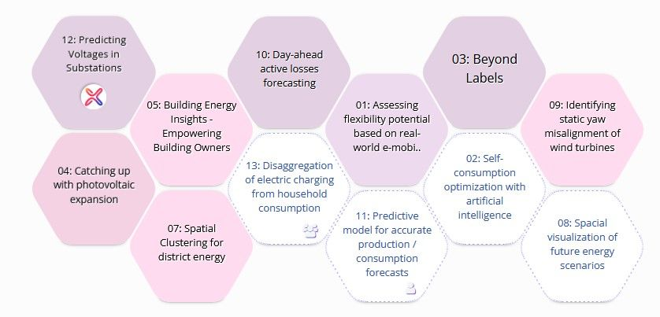
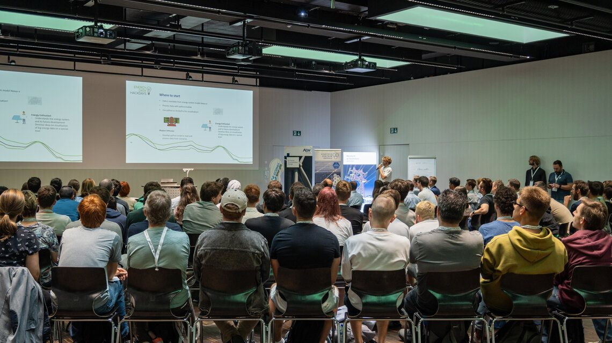
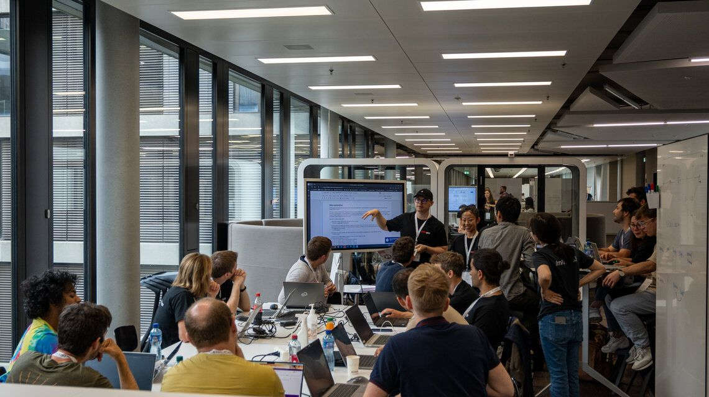
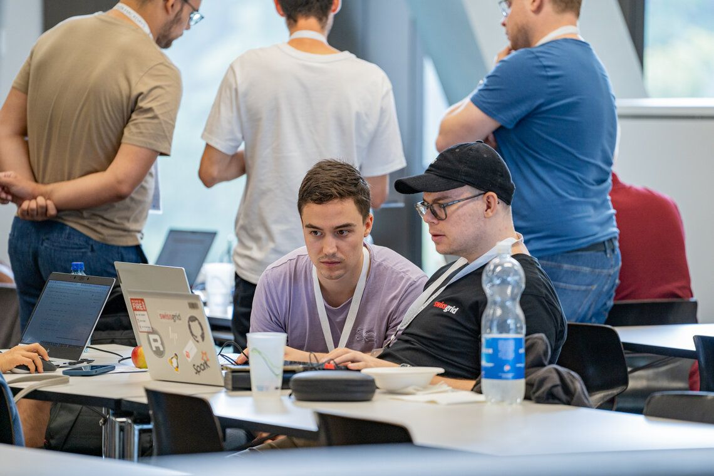
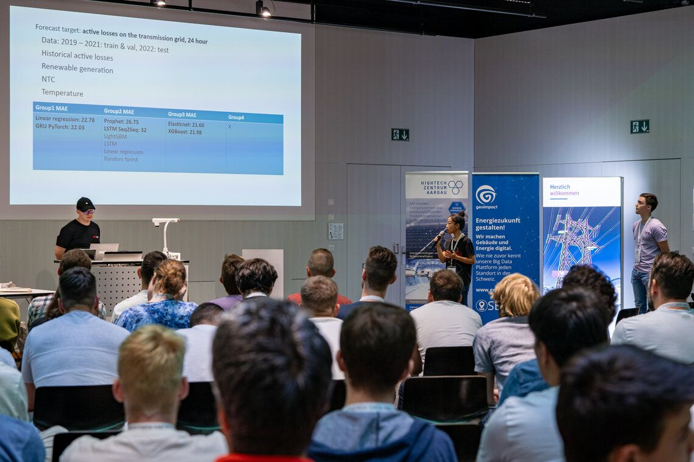
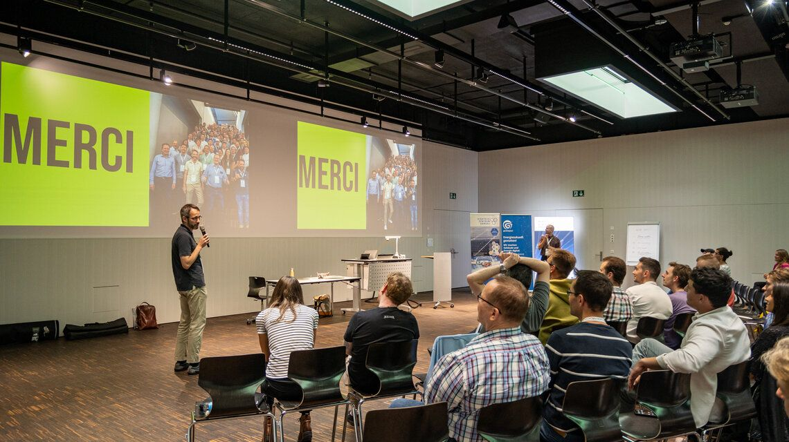

### Was ist eine partizipative Veranstaltung?

Unter [partizipativen Veranstaltungen](https://www.event-partner.de/business/partizipative-veranstaltungsformate-sorgen-fuer-involvement-und-interaktion/) versteht man eine Sammlung unterschiedlicher Events. Das können Hackathons, Open Spaces, Barcamps oder Meet-Ups sein. Obwohl sie zum Teil sehr unterschiedliche Formate und Ziele haben, haben sie eines gemeinsam: Die Teilnehmenden beteiligen sich partizipativ. Partizipativ bedeutet, dass die Teilnehmenden nicht wie zum Beispiel an einer Konferenz nur tagelang zuhören, sondern sich aktiv einbringen.

Folgend eine Auflistung, was es aus meiner Sicht braucht, damit ein Hackathon partizipativ ist.

> 💡 Was macht einen Hackathon partizipativ?  
>   
> 1\. Mehrere Personen arbeiten zusammen an einem oder mehreren Projekten.  
> 2\. Teilweise werden Gruppen gebildet.  
> 3\. Jede Person bringt ihr Wissen und ihre Erfahrung in die Lösung einer Aufgabestellung oder eines Problems ein.  
> 4\. Dadurch können Lösungen gefunden werden, die auf die eine einzelne Person kaum gekommen wäre.  
> 5\. Dies bedingt, dass die Inputs aller Teilnehmenden beachtet, gehört, gegebenenfalls zusammen hinterfragt und verarbeitet werden.  
> 6\. Am Schluss der Veranstaltung präsentieren die Teams ihre Resultate oder Lösungsansätze. Dadurch gewinnen auch andere Teams neue Erkenntnisse und finden möglicherweise Lösungen für Problemen, die sie nicht beheben konnten.  
> 7\. Sinnvollerweise gibt es Folgeprojekt, bei dem Teilnehmende des Hackathons weiter an der Fragestellung arbeiten und die Lösungen verbessern können.

Bei Barcamps habe ich ursprünglich gedacht, dass das Meet-Ups sind, die tatsächlich in einer Bar oder Pub abgehalten werden. Offenbar beginnen sie häufig aber schon beim Frühstück.

> 💡 Was macht ein Barcamp partizipativ?  
>   
> 1\. Bereits beim Kickoff lernen sich die Teilnehmenden kennen und erfahren, wer was einbringt.  
> 2\. Alle Personen können danach eigene Projekt, Themen oder Fragestellungen einbringen. Dies grenzt Barcamps von Hackathon oder Konferenzen ab, wo dies schon im Voraus organisiert wird.  
> 3\. Die Themen werden in sogenannten Session abgehandelt. Dabei kann man flexibel zwischen verschiedenen Sessions wechseln. Bei Hackathons bleibt man in der Regel für die ganze Dauer bei einem Thema.  
> 4\. Gegen den Abend findet ein lockerer Ausklang über die Sessions hinaus statt.

Anhand der Beispiel von Hackathons und Barcamps wird ersichtlich, dass im Vergleich zu einer Konferenz nicht einzelne Referenten, sondern der Teilnehmende selber im Fokus steht. Das offene Format lässt auch zu, dass nicht nur ein Thema behandelt wird, sondern ganz unterschiedliche Themen und Fragestellungen bearbeitet werden. Ich werde dies später anhand der Energy Data Hackdays genauer erklären.

Ein verbreitetes Stichwort bei partizipativen Veranstaltungen ist die sogenannte Schwarmintelligenz. Diese wird auch als «[Weisheit der Vielen](https://www.fuereinebesserewelt.info/workshop-mit-kollektiver-intelligenz/)» bezeichnet. Es geht dabei darum, dass mehrere Personen, zum Beispiel, ein Problem besser lösen können, als eine einzelne Person. Nicht nur haben unterschiedliche Personen unterschiedliches Wissen, sondern geht auch jede Person Probleme anders an. Dies kommt davon, dass jede Person anders denkt und unterschiedliche Lösungsansätze erarbeiten kann.

Von partizipativen Veranstaltungen, insbesondere von einem Hackathon erwarte ich zusätzlich auch, dass Teilnehmende mehr lernen, als zum Beispiel an einer Konferenz oder Vorlesung. Denn es wird real an einem Problem gearbeitet und die Ideen anderer Personen ausprobiert. Als Teilnehmer habe ich also die Möglichkeit, Probleme aus der Sicht und mit der Methode anderer Personen anzugehen. An einer Konferenz lerne ich zwar auch neues, zum Beispiel über eine Architektur von neuronalen Netzen zur Erkennung von Objekten auf Bildern. Aber an einem Hackathon wende ich dieses Wissen direkt an und kann unterschiedliche Methoden ausprobieren und mir ihr experimentieren.

Aus meiner Sicht sind partizipative Veranstaltungen deshalb nicht nur Events, an denen man gratis arbeitet, sondern sich auch wertvolles Wissen aneignen und Kontakte knüpfen kann.

### Inwiefern sind die Energy Data Hackdays 2023 in Brugg partizipativ und was erwarte ich mir davon?

Nachdem ich aufgezeigt habe, was eine Veranstaltung partizipativ macht, möchte ich nun darstellen, wie die von mir ausgewählte Veranstaltung diese Kriterien erfüllt.

Nachdem ich mich für das Modul «Partizipative Veranstaltungen durchführen» angemeldet habe, habe ich mich auf die Suche nach einer geeigneten Veranstaltung gemacht. Diese soll nicht nur die Anforderungen von dem Modul erfüllen, sondern mir auch Spass machen. Ursprünglich wollte ich meine Teilnahme an der «Conser-vision Practice Area: Image Classification» von [DrivenData](https://www.drivendata.org/competitions/87/competition-image-classification-wildlife-conservation/) mit diesem Modul verbinden. Da diese aber gemäss den erwähnten Kriterien zu wenig, resp. gar nicht partizipativ ist, habe ich eine physisch stattfindende Veranstaltung gesucht. Ich habe allerdings kaum solche gefunden, vermutlich ist das weiterhin eine Folge der Corona Pandemie. Ursprünglich wollte ich an den Data Hackdays BE teilnehmen. Da ich aber gleichzeitig an der Fantasy in Basel arbeiten konnte, habe ich mich entschieden, an den Energy Data Hackdays teilzunehmen. Diese finden nicht nur bei uns am FHNW Campus statt, sondern es werden auch mehrere Challenges, die mich ansprechen, angeboten.

An den [Energy Data Hackdays](https://energydatahackdays.ch/energy-data-hackdays/energy-data-hackdays-2023) werden dreizehn unterschiedliche Themen, resp. Challenges, angeboten. Davon sprachen mich im Vorfeld mindestens drei an. Es handelt sich bei diesen um Aufgabestellungen, bei denen Zeitreihen prognostiziert werden müssen.

*Überblick der Challenges, [Energy Data Hackdays 2023](https://energydatahackdays.ch/energy-data-hackdays/energy-data-hackdays-2023)*

Insgesamt handelt es sich um eine sehr breite Palette an Challenges, die, wie der Name sagt, auf den Energiesektor ausgerichtet sind. Obwohl ich keinen persönlichen Bezug zur Branche habe, zeigt es auf, wie vielfältig Data Science angewendet werden kann.

Gemäss den Beschreibungen der Homepage erfüllen die Hackdays alle Anforderungen an einen Hackathon, die ich anfangs aufgelistet habe. Es wird zum Beispiel partizipativ an Lösungen gearbeitet und diese werden danach von den Teams vorgestellt. Auf der Webseite werden diverse [Erfolgsgeschichten](https://energydatahackdays.ch/success-stories) vorgestellt, die beweisen, dass die Arbeiten in der Praxis angewendet werden. Sie zeigen auch [Impressionen](https://energydatahackdays.ch/energy-data-hackdays), der letzten Jahre, bei denen die Zusammenarbeit in den Teams und die Präsentationen dokumentieren.

Ich erwarte also, dass dieser Event dem Musterbeispiel eines Hackathons entspricht.

### Was habe ich an den Energy Data Hackdays erlebt?

Freitag, 9 Uhr morgens ging mein erster Hackathon los. Neben zwei Mitstudenten waren drei als Challenge-Owner dabei. Nachdem wir uns zuvor schon registriert und ein paar Goodies und Gipfeli geschnappt haben, begann das Intro zu den Hackdays. Neben dem Konzept und Programm der beiden Tage durften sich auch die Hauptsponsoren vorstellen. Danach wurden die einzelnen Challenges gepitcht. Die Owner hatten dafür nur drei Minuten Zeit, wer wollte, konnte sich aber schon im Vorfeld informieren. Ich habe das auch gemacht und habe mich während den Pitches aus drei Favoriten für die Challenge «Day-ahead active losses forecasting» von Swissgrid entschieden. Nach den Pitches wurden die Gruppen gebildet. Wir hatten dafür rund 30 Minuten Zeit, was einige Teilnehmer genutzt haben, um sich direkt mit den Challenge-Ownern auszutauschen und Fragen zu stellen.

*Pitch der Challenges, [Energy Data Hackdays 2023](https://energydatahackdays.ch/energy-data-hackdays/energy-data-hackdays-2023)*

Für die Challenge von Swissgrid haben sich mit mir rund 20 Teilnehmer angemeldet. Die Owner haben sich eine rege Teilnahme erhofft und hatten schon geplant, dass mehrere Teams gegen einander antreten können. Das beste Team darf als Anreiz ihre Lösung bei Swissgrid vorstellen.

Mein Anreiz für die Challenge war allerdings die Problemstellung. Es sollte aus vergangenen Daten (Zeitreihen) der Stromverlust im Schweizer Netzwerk prognostiziert werden. Ich habe mich bereits im letzten Semester mit entsprechenden Deep Learning Methoden auseinandergesetzt und wollte dieses Wissen nun in einer realen Problemstellung verbessern. Für Swissgrid ist die Thematik wichtig, da sie nicht richtig vorhergesagte Differenzen für viel Geld am Strommarkt ausgleichen müssen. Die Challenge haben sie also nicht zum Spass, sondern aus betrieblichen Interessen, gestellt.

Nachdem die Teambildung abgeschlossen war (11 der 13 Challenges haben Teilnehmer erhalten), haben wir uns in der Challenge zusammengesetzt und erhielten vertiefte Informationen. Jeder Teilnehmer bekam auch Zugriff auf die Daten und Rechenpower (inkl. GPU) von Swissgrid. Danach haben wir vier Teams gebildet und uns innerhalb dieser Team an die Arbeit getan.

*Kick-Off unserer Challenge, [Energy Data Hackdays 2023](https://energydatahackdays.ch/energy-data-hackdays/energy-data-hackdays-2023)*

Mein Team bestand nur aus (quasi) Data Scientisten, wovon drei noch im Studium sind und zwei diesen als Beruf ausüben. Allerdings hatte niemand Erfahrung mit dem Energiesektor. Wir mussten deshalb viel Zeit in das Kennenlernen und Verstehen der Daten investieren, aber das macht Data Science ja so spannend. Obwohl uns aufbereitete Daten versprochen wurden, haben wir dabei einige Stolpersteine gefunden.

Nach der Mittagspause, die in der bekannten Kantine an der FHNW stattgefunden hat, haben wir uns mit ersten Modellen befasst. Hier hat sich bereits ein Teamproblem herauskristallisiert: Wir konnten uns nicht auf ein gemeinsames Vorgehen und eine Aufgabenteilung einigen. Ein Teil der Gruppenmitglieder wollte für sich alleine arbeiten und ging nicht auf Vorschläge der anderen Hälfte ein. Zu Beginn des Nachmittags war das auch noch in Ordnung, da alle weiterhin in der Findungsphase mit den Daten und Modellen war. Im Verlauf des Nachmittags wurde es aber eher mühsam, da Probleme auftauchten, für deren Lösung ein strukturiertes Vorgehen hilfreich gewesen wäre. Der partizipative Gedanken ging in diesem Teil aufgrund der Teamdynamik verloren, trotz der eigentlich gesunden Wettkampfsituation.

Nach dem Abendessen, das leider nur aus das aufgewärmten Käsekuchen und Salat vom Mittagessen bestand, hat sich im Team langsam Müdigkeit ausgebreitet. Trotz der ausbleibenden Arbeitserfolge (Implementation und Debugging von Deep Learning Modellen), blieb die Stimmung im Team gut. Die Challenge-Owner sassen neben und wir hatten dadurch auch mit ihnen einen guten Austausch.

*Arbeit an der Swissgrid Challenge, [Energy Data Hackdays 2023](https://energydatahackdays.ch/energy-data-hackdays/energy-data-hackdays-2023)*

Am nächsten Morgen habe ich direkt zu Beginn nochmals probiert ein strukturiertes Vorgehen im Team zu lancieren. Da es wiederum von der Hälfte ignoriert wurde (über die Gründe will ich in einem öffentlichen Blog nicht spekulieren), haben wir es aber sein lassen. Da es sich um einen freiwilligen Anlass gehandelt hat und wir nicht die Challenge-Owner waren, hätte es keinen Sinn gemacht, die Situation «strikter» zu behandeln. In der Folge hat jeder an seinen eigenen Modell gearbeitet. Ich habe zuerst viel Zeit mit einem LSTM verloren, konnte aber immerhin am zweiten Morgen ein lineares Modell, Decision Tree und einen Random Forest implementieren. Aufgrund der schlechten Resultate habe ich diese aber nicht zur Überprüfung durch die Challenge-Owern (sie haben die Modelle anhand für uns unbekannter Daten verifiziert) eingereicht. Aufgrund mehrerer Aussetzer der Cloud und weil die Überprüfung durch die Owner deutlich länger gedauert hat, als geplant, hat sich unser Team auf die Einreichung von zwei Modellen beschränkt. Es hat sich um ein LSTM Seq2Seq und ein Prophet Modell gehandelt. Leider haben wir die Challenge nicht gewinnen können.

Das Gewinner-Modell war basierend auf der ersten Analyse nicht besser, als das Modell, das Swissgrid bereits anwendet. Es ist aber offenbar nicht viel schlechter. Aufgrund der sehr limitieren Zeit ist es für mich nicht überraschend, dass es nicht so gut ist, wie eines, das über eine längere Frist erstellt wurde. Ich gehe davon aus, dass mit mehr Zeit ein besseres Modell möglich wäre. Verständlicherweise wollten die Owner keine genauen Beträge nenne, doch zwischen dem besten und schlechtesten eingereichten Modell, die nicht weit auseinander lagen, hätte sich für Swissgrid eine Einsparung von jährlich CHF 500'000 ergeben. Das beweist, dass Swissgrid die Challenge auch aus betrieblichen Gründen angeboten hat. Swissgrid veröffenltich die Codes aller Teams in einem [Github Repo](https://github.com/Swissgrid-AG-External/energydatahackdays23).

Am frühen Nachmittag haben sich alle Teilnehmer der Energy Data Hackdays nochmals versammelt. Für jede Challenge wurden die Resultate vorgestellt und es konnten Fragen gestellt werden. Für keine Challenge konnte ein fertiges Produkt erstellt werden. Aber ich habe aus den Präsentationen herausgehört, dass trotzdem viele Challenge-Owner zufrieden mit den Resultaten waren und auf vielem aufgebaut werden kann. Ich gehe also davon aus, dass es für sie deshalb ein Erfolg war.

*Challenge-Owner präsentieren unsere Resultate, [Energy Data Hackdays 2023](https://energydatahackdays.ch/energy-data-hackdays/energy-data-hackdays-2023)*

Die Energy Data Hackdays 2023 wurden mit einem feinen Apéro und letzten Diskussionen über die Resultate beendet.

### Haben die Hackdays meine Erwartungen an einen partizipative Veranstaltung erfüllt?

Aus meiner Sicht haben die Energy Data Hackdays alle Anforderungen an eine partizipative Veranstaltung erfüllt. Ich zeige diese anhand der zu Beginn dieses Blogs aufgestellter Anforderungen dar:

1\. Es haben über 100 Teilnehmer an 11 unterschiedlichen Challenges gearbeitet.

2\. Bei unserer Challenge wurden vier Teams mit insgesamt 19 Teilnehmer gebildet. Die Challenge-Owner haben also vier unterschiedliche Lösungen erhalten (resp. unterschiedliche Modelle aus vier Teams). Der Nutzen davon ist, dass sie so noch mehr Lösungen und Ideen erhalten haben, als wenn es nur ein Team gegeben hätte.

3\. Zwar konnte jeder sein Wissen einbringen, doch in meinem Team hat das nur bedingt geholfen. Es wurde leider nicht das Wissen mehrerer Personen verknüpft. Dies hätte besser organisiert werden sollen, wir haben es aber aus den genannten Gründen nicht forciert.

4\. Von anderen Teams habe ich gehört, dass sie partizipativ zusammengearbeitet haben. Ich gehe deshalb davon aus, dass deren Lösungen aus der Mischung von Wissen und Ideen unterschiedlicher Personen stammen und so alternative Lösungen gefunden worden.

5\. Ich gehe auch hier davon aus, dass das in anderen Teams passiert ist.

6\. Am Schluss wurden die Lösungen aller Challenges präsentiert. Die restlichen Teilnehmer haben auch Fragen gestellt und Inputs gebracht, die die Challenge-Owner mitnehmen konnten.

7\. Viele Challenge-Owner haben bei den Präsentationen gesagt, dass sie Lösungen und Ideen erhalten haben, auf die aufgebaut werden wird. Es halt sich also für die ausgezahlt, die Challenge am Hackathon zu stellen.

## Reflexion der Energy Data Hackdays 2023

Aus meiner Sicht haben die Veranstalter einen guten, partizipativen Hackathon veranstaltet. Die wichtigsten, genannten Kriterien haben sie eingehalten und haben dadurch eine partizipative Teilnahme der Challenge-Owner und Teilnehmer ermöglicht. Einzig bei den Schlusspräsentationen hätten sie es aus meiner Sicht besser machen können. Für jede Challenge waren drei Minuten Präsentation erlaubt. So konnten nur die wichtigsten Resultate knapp aufgezeigt werden. Ein Austausch mit den Zuhörern und vertiefte Nachfragen waren deshalb kaum möglich. Hier wäre mehr Zeit sinnvoll gewesen. Auch wenn ich das Argument, dass die Präsentationen sonst über eine Stunde gegangen wäre, natürlich nachvollziehen kann.

Vom Challenge-Owner habe ich eine sehr interessante Aufgabenstellung erhalten und konnte mein Wissen an realen Daten testen und anwenden. Ich hätte mir allerdings drei Verbesserungen gewünscht. Zuerst haben sie uns aufbereitete Daten versprochen, dies waren sie zwar grösstenteils, doch haben wir einige Probleme und sogar fehlende Monate gefunden. Dies hat bereits zu Beginn einige wertvolle Stunden gekostet. Dann kamen die Infrastruktur (Server) am zweiten Tag schnell an ihre Grenzen und die Überprüfung der Modell mussten wir zuletzt selber durchführen. Am meisten Mühe hatte ich aber mit der Teamdynamik. Als einzelne Teilnehmende konnte wir nicht viel dagegen unternehmen und uns beim Owner beschweren wäre für den Event übertrieben gewesen. Es ist zwar gut, dass uns der Owner komplette Freiheit gelassen hat, doch würde ich als Owner zukünftig Teamreports, die solche Probleme erkennen könnten, anfordern. Trotz allem haben sie aber zahlreiche Lösungen erhalten und konnten Kontakt mit vielen motivierten Data Scientisten knüpfen, was vielleicht mal berufliche Chancen ermöglicht. Aus meiner Sicht können die Challenge-Owner ebenfalls zufrieden mit dem Resultat sein.

> 💡 Data Science ist auch ausserhalb der FHNW Bubble vielfältig und engagiert!

Für mich selber war ich glücklich mit der Teilnahme an den Energy Data Hackdays 2023. Einerseits habe ich das erste Mal an einer partizipativen Veranstaltung teilgenommen. Ich habe gelernt, wie sie ablaufen, wie die Stimmung allgemein ist und wo Hürden auftauchen können. Am wertvollsten war aber der Kontakt mit anderen Data Scientisten ausserhalb der FHNW Bubble. Ich hatte bisher noch keine Kontakte und habe erfahren, wie vielfältig und engagiert die Community ist.

*Und schon waren die Energy Data Hackdays 2023 Geschichte..., [Energy Data Hackdays 2023](https://energydatahackdays.ch/energy-data-hackdays/energy-data-hackdays-2023)*
