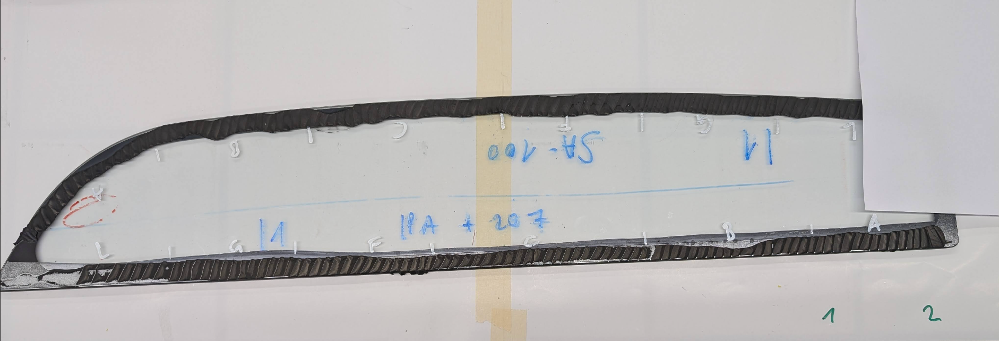
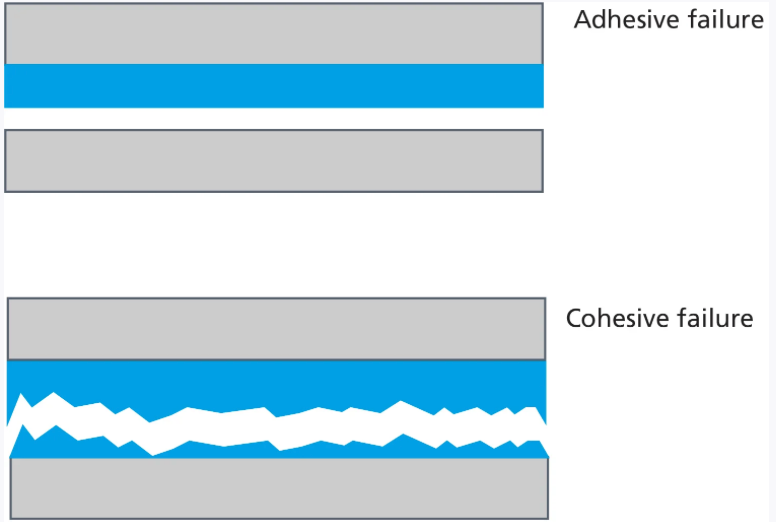
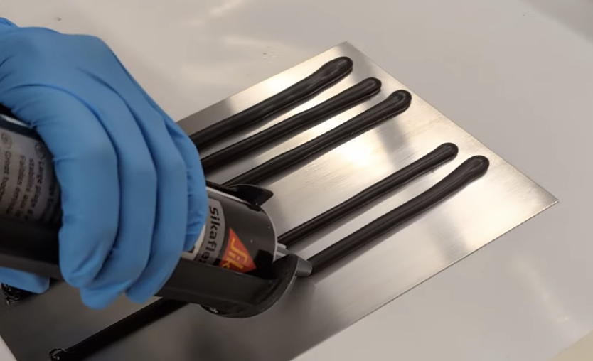
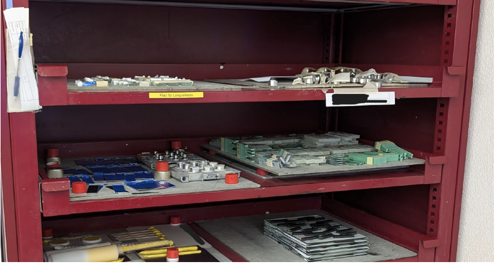
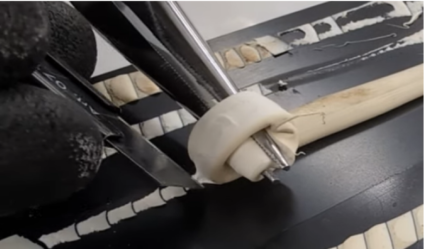
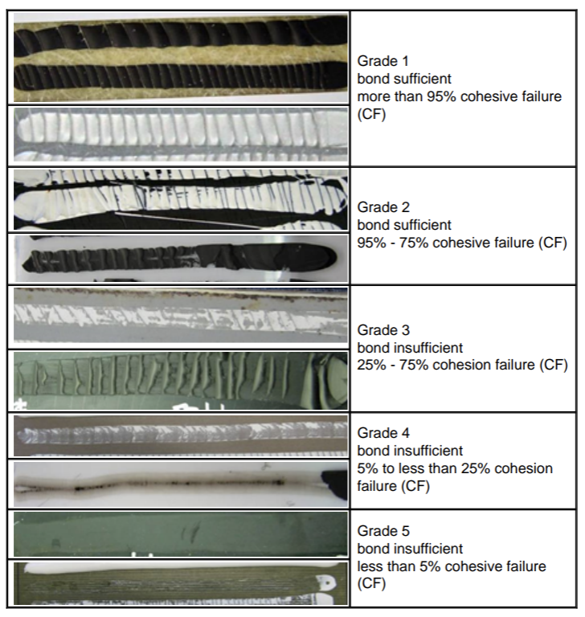

**What if your car’s windshield came loose while driving?** Modern vehicles rely on industrial adhesives, applied as narrow beads (“caterpillars”), to keep the glass safely in place. Before any glue reaches production, it must pass several lab tests that simulate years of real-world stress.

In our bachelor’s thesis at FHNW (Hochschule für Informatik), in collaboration with Sika Services AG, we built a computer-vision system that classifies these adhesive beads into five quality categories (1 = very good … 5 = very poor) to standardize evaluation (see Fig. 1 for an example of applied glue on a windshield).

*Fig. 1 - example of a glue test on a windshield*

## Why use machine learning?

Humans are great at spotting patterns, but consistency isn’t our strong suit. The people who currently classify the glues (experts at Sika Services AG) can be inaccurate or inconsistent. For example, we are easily influenced by anchoring bias: the first sample we see becomes an anchor, and we judge all subsequent samples relative to it. If an inspector first sees a very poor glue and then a mediocre one, the second may be perceived as “very good” simply because the anchor was so bad.

*Fig. 2 - Anchoring bias*

Machines, in contrast, are not subject to this kind of cognitive bias. A computer vision model can estimate, with pixel-level precision, how much adhesive has adhered to the substrate. It also does not get tired and is not affected by time of day or weekday. People, for instance, often make more positive judgments on a Friday afternoon than on a Monday morning.

### Adhesion vs. Cohesion: why it matters here

We introduce adhesion and cohesion because production safety depends on both.

-   **Cohesion** is the **internal strength** of the glue. (how well the adhesive holds to itself) It’s measured with instruments such as tensiometers under defined loads.
-   **Adhesion** is the **bond to the substrate** (e.g., glass or metal). That’s what our imaging approach targets. After environmental exposure, how much adhesive **remains on the substrate** (and what failure mode do we see)? This residue is a visible proxy for a strong adhesive bond. *(See Fig. 3 for a visual explenation of Adhesive failure vs Cohesive failure.)*

Our work automates the adhesion assessment. The strength of the adhesive also depends on cohesive failures, which will be explained in sectionill be clearly explained in section "Classes" and Fig. 7)

*Fig. 3 - Cohesion vs Adhesion*

To measure adhesion, we follow a structured testing protocol:

**1\. Application:** Several glue caterpillars are applied to the substrate as you can see in Fig. 4.

*Fig. 4 - Glue applied to the substrate*

**2\. Conditioning**: The samples undergo several exposures, which are immersion in water, heat‐cycling in an oven, and humidity in a moisture chamber. Following each exposure, the samples are moved to a drying chamber, as shown in Fig. 5.

*Fig. 5 - Drying chamber*

**3\. Evaluation**: After each exposure step, one caterpillar is peeled off with a clamp. The amount of adhesive remaining indicates the adhesive bond’s strength. (See Fig. 6 for a testing process after the exposures)

*Fig. 6 - Testing process after exposure*

These exposure tests try to simulate real world conditions and problems, which the glues will face during a lifespan. So ideally a glue will be able to withstand all of the tested exposures.

### Dataset

Experts of the Sika Services AG collected ~**1,100** paired images of adhesive beads using an **iPhone SE** camera under a fixed setup. Images were **labeled by the employers as well**, who assign each sample to **five categories** (1 = very good … 5 = very poor) based on **visible residue and failure mode**. We use those expert labels to train and evaluate the model.

### Classes

Each sample is assigned to one of **five categories**. Those range from 1 (very good) to 5 (very bad). The grades are defined by the percentage of **cohesive failure (CF)**, meaning how much adhesive remains on the substrate after the peel test. A higher CF means a stronger adhesive bond. As illustrated in Fig. 7. 

*Fig. 7 - Classes of glue strength*

#### Machine Learning Model

We experimented with several machine-learning architectures to get a model, which is able to analyze the image of the glue caterpillar and tell correctly which class the glue belongs to. A **Vision Transformer (ViT)** performed best, achieving **~0.93 accuracy** on the test set. That means that 93% of all predictions from the model were actually true.

### Web application

As a final step, we built a web application **for lab technicians** at Sika Services AG. Using a smartphone, they capture images of the substrate and glue caterpillars before and after the exposure tests. The model processes the photos, estimates how much adhesive was lost from the substrate, and returns a performance grade on the 1 to 5 scale, as explained earlier in section "Classes". All images and results are then uploaded to an external database, so records are saved, searchable, and accessible from any computer. Using the web application speeds up the process and lowers the risk of human errors such as biases.

### From Prototype to Practice

We showed that image-based assessment of adhesive residues can be automated and yields consistent five-class ratings. Our best model, a Vision Transformer, reached about 0.93 accuracy, with most remaining errors occurring between classes 2 and 3. The accompanying web application turns this model into a practical lab tool, speeding up testing and creating an auditable record for Sika Services AG.

The main limitations are image capture quality and label quality. Standardized imaging, more diverse data, and periodic retraining are the clearest paths to greater robustness. Experts remain involved for edge cases and ongoing quality control, ensuring that the system complements, rather than replaces, human judgment.
