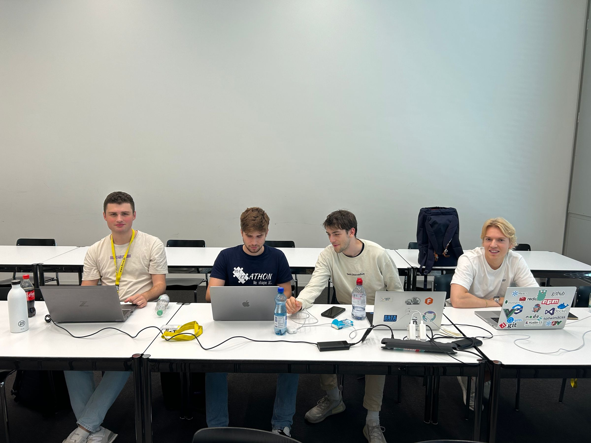
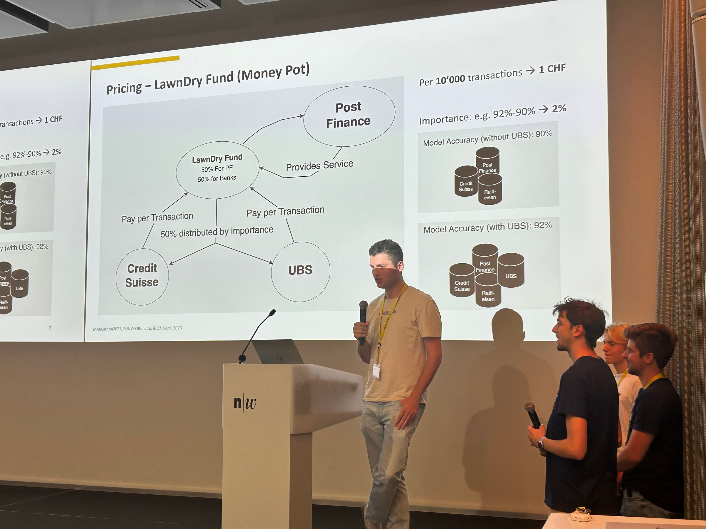
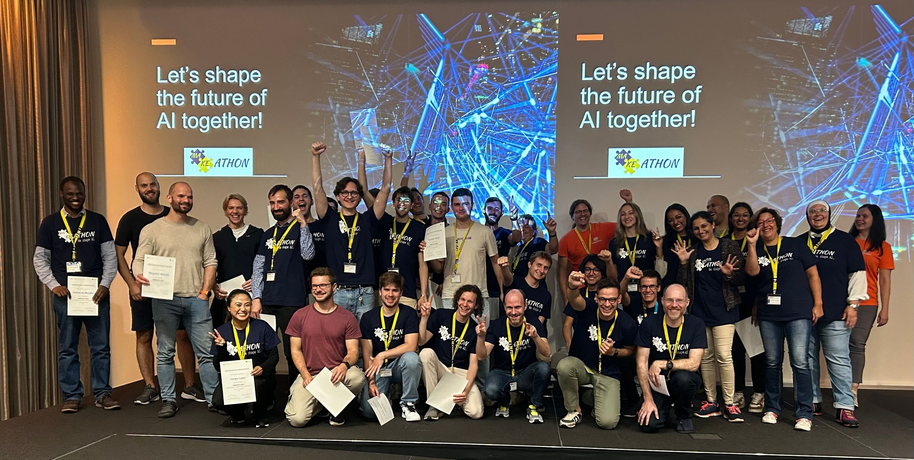

## Einleitung

Im Rahmen meines Data-Science-Studiums habe ich das Modul PVD (partizipative Veranstaltungen durchführen) besucht. Den Leistungsnachweis kann man auf zwei Arten erbringen: Entweder organisiert man eine partizipative Veranstaltung oder man nimmt 36h Stunden an einer (oder mehreren) partizipative Veranstaltung teil. Da ich dieses Jahr wieder den MAKEathon besuchen wollte, habe ich mich für letztere Option entschieden.

### MAKEathon?

Der [MAKEathon](https://makeathonfhnw.ch/) ist ein Hackathon, der dieses Jahr zum vierten Mal von der Intelligent Information Systems Research Group der FHNW-Business organisiert wurde. MAKE steht für **M**achine Le**A**rning und **K**nowledge **E**ngineering. Dabei geht es darum, eine Challenge mit einer Kombination aus maschinellem Lernen und explizitem Wissen zu meistern.

### Was bedeutet partizipativ?

*partizipativ* kommt aus dem lateinischen und heisst so viel wie “unter Beteiligung der Betroffenen \[stattfindend, ausgeführt\]“ (partizipativ, duden.de). Das heisst, dass sich die Teilnehmenden des MAKEathon aktiv einbringen und beteiligen. Ihre unterschiedlichen Blickwinkel und Erfahrungen helfen der ganzen Gruppe vorwärtszukommen. Wichtig ist auch, dass alle Betroffenen auf Augenhöhe agieren und Entscheidungen in der Gruppe gemeinsam treffen und nicht eine Person als Chef\*in agiert.

### Ist der MAKEathon partizipativ?

Beim MAKEathon kommen Personen zusammen um in Gruppen (ca. 4-5 Personen) gemeinsam eine Challenge zu meistern. Die Challenge erfordert nicht nur technische Skills, denn auch Wissen und Fähigkeiten aus dem Businessbereich sind gefragt. Die optimale Gruppe setzt sich deshalb aus Wirtschafts- sowie Technikstudenten zusammen. Des Weiteren müssen in der Gruppe immer wieder gemeinsame Entscheidungen getroffen werden, z.B. welchen Ansatz die Gruppe weiter verfolgt. Gerade dort kann man von den enterschiedlichen Erfahrungen und Blickwinkeln der Personen in der Gruppe profitieren.

### Was erwarte ich?

Ich erwartete vom MAKEathon, dass ich eine grossartige Zeit verbringen kann, neue Personen kennenlerne, gemeinsam eine Challenge meistern und dabei mein Wissen einbringen kann sowie Neues lerne (von der Challenge sowie von meinen Teamkolleg\*innen). Ich habe den MAKEathon schon letztes Jahr besucht und er hat alle meine Erwartungen erfüllt. So freute ich mich auch dieses Jahr wieder auf ein tolles Team.

## Der MAKEathon

### Tag 1

Um 8:30 betrat ich das Gebäude der FHNW in Olten. Am Empfang fasste ich meinen Badge und ein MAKEathon T-Shirt. Das T-Shirt zog ich gleich an. Anders als es im Ticketshop beschrieben war, wurden die 20 Franken, welche ich für das Ticket ausgegeben habe, leider nicht rückerstattet. Der Anlass geniesst eine gewisse Popularität in unserem Studiengang, weshalb ich nicht alleine ging und auf die acht weiteren Kommilitonen wartete.

Das Event startete wie jedes Jahr, indem der Organisator Emanuele Laurenzi unser Energie-Level abfragte (oder besser gesagt aktivierte). Danach bekamen wir eine Einführung in die dritte Welle von KI, Machine Learning und Knowledge Engineering. Anschliessend hatte jeder Challengeprovider 5 Minuten Zeit uns seine Challenge zu pitchen. Wir hatten 9 spannende Challenges von diversen Unternehmen wie PostFinance, Metaphacts, Axians, etc.

Danach hatten wir Zeit Gruppen zu bilden und die Challengeprovider auszufragen. Ich tat mich mit Etienne zusammen, und uns war schnell klar, dass wir die Anti-Money-Laundering Challenge von PostFinance bestreiten wollten. Wir fanden zwei Informatikstudenten im ersten Semester (Andrei und Nicolas) und einen Businessstudenten, die sich uns anschlossen. Der Businessstudent verliess uns leider am selben Morgen und wechselte zu einer anderen Gruppe. Wir bedauerten den Abgang sehr, da wir eine wichtige Perspektive verloren, gerade weil unsere Challenge auch einen nicht zu vernachlässigenden Businessteil hatte.

Bevor wir noch richtig starten konnten, war bereits Mittag. Wir gingen in die Mensa, wo wir unseren Teller mit feinem Essen von einem Buffet randvoll füllen konnten. Das Mittagessen war, wie jede andere Mahlzeit auch, vom MAKEathon offeriert. Während der Mittagspause konnten wir bereits Ideen zur Challenge austauschen. So konnten wir unsere verschiedenen Ansichten kennenlernen und gemeinsam grundlegende Entscheidungen treffen.

### Die Challenge: Anti-Money-Laundering

Damit PostFinance ihre Geschäfte rechtskonform abwickeln kann, muss sie Fälle von Geldwäscherei erkennen. Um diesen Prozess zu automatisieren, braucht PostFinance viele Daten, denn Fälle von Geldwäscherei sind sehr selten. Ihre Idee war, dass sie die Daten von anderen Banken kombinieren könnte und so mehr Fälle von Geldwäscherei hatte. Das Problem ist allerdings, dass die Banken nicht einfach so ihre Transaktionsdaten herausgeben dürfen/werden. Deshalb sollte die künstliche Intelligenz dezentral bei jeder Bank trainiert werden und danach kombiniert werden. Teil der Challenge war auch das Finden von einem Business Use-Case, um das Modell zu monetarisieren.

### Vorgehen

Zu Beginn haben wir unsere Ideen zur Challenge ausgetauscht, uns ins Thema eingelesen und Fragen/Unklarheiten in der Gruppe diskutiert. Das lief sehr gut, wir konnten uns so schnell Wissen aneignen.

Etienne und ich haben mehrmals Andrei und Nicolas Machine Learning Konzepte auf einem sehr einfachen Level erklärt. Das Herunterbrechen auf ein sehr einfaches Level hat es erleichtert, zu überprüfen, ob und wie wir ein Konzept in unserer Challenge anwenden können. Auch das kritische Nachfragen der Beiden hat uns gezeigt, dass man Dinge auch anders auslegen kann und unsere Ansicht nicht immer die einzig richtige ist.

Meine Aufgabe war es mit Andrei die Daten aufzubereiten und zu analysieren. Etienne hat sich mit Nicolas um das dezentrale Machine Learning Modell gekümmert. Als Methode haben wir Federated Learning verwendet. Andrei und ich waren früher als die beiden anderen fertig, und wir haben sie noch unterstützt beim Aufsetzen des Federated Learning.

*Unser Team LawnDry bei der Arbeit*

### Abendessen

Zum Abendessen verspiesen wir eine Pizza, die wir bereits am Morgen bestellt hatten. Wir tauschten uns mit den anderen Teams über den Fortschritt aus. Es tat gut zu hören, dass nicht nur wir noch so viel vor uns haben. Dadurch konnten wir unser Hochstapler-Syndrom ein bisschen mindern und haben dadurch noch mehr Motivation geschöpft.

Nach dem Abendessen setzten wir uns wieder zusammen und arbeiteten weiter. Um ca. 19:30 Uhr beschlossen wir nach Hause zu gehen und unterwegs sowie zu Hause noch weiter an unserer Challenge zu arbeiten. Ausgetauscht haben wir uns über WhatsApp. Schliesslich haben wir um 23 Uhr das Federated Learning zum Laufen gebracht.

### Tag 2

Den zweiten Tag starteten wir um 9 Uhr mit Gipfeli und Kaffee. Es ging nun noch um das Fixen einzelner Bugs sowie das Finden eines Business-Use-Cases und das Erstellen eines Pitch. Die Bugs fixten wir im Verlauf des Morgens. Hilfreich war dabei, dass wir alle sehr nahe beieinandersassen und wir uns so schnell austauschen oder gemeinsam etwas debuggen konnten.

Nach dem Mittagessen kümmerten wir uns um das Businessmodell. Wir spielten mehrere Ideen im Team herum und skizzierten diese an einem Whiteboard. Wir gelangten schlussendlich bei einem Modell an, bei dem jede Bank pro Transaktion in einen Geldtopf einzahlt und dieses Geld dann auf die PostFinance (für das Entwickeln des Systems und Betreiben der Infrastruktur) und die restlichen Banken verteilt wird. Die restlichen Banken erhalten gemäss ihrer Verbesserung des Modells einen entsprechenden Anteil.

Den Pitch erstellten wir gemeinsam und nahmen keine Aufgabenaufteilung vor. Dadurch hatten wir einen kürzeren Feedbackloop im Vergleich zu einem Review. Beim Erstellen des Pitches fiel uns auch auf, dass unser Knowledge-Engineering-Teil lediglich aus Ideen besteht, die nicht direkt Teil der Lösung sind. Trotzdem präsentierten wir unsere Lösung. Der PostFinance gefiel besonders unser Businessmodell.

*Der Pitch unserer Lösung*

### Podest?

Nach einem Apéro (das mehr ein Abendessen war) wurden die Ränge verkündet. Für den ersten Platz hat es leider nicht gereicht. Das dachten wir uns aber schon, weil wir den Knowledge-Engineering-Teil vernachlässigt hatten. Dennoch haben wir es auf den zweiten Platz geschafft. Dafür haben wir jeweils einen Gutschein von Digitec über 100 CHF erhalten.

## Reflexion

Der MAKEathon war durchzogen von Partizipation. Aufgaben in der Challenge wurden von allen bearbeitet. Entscheidungen haben wir gemeinsam getroffen. Fragen konnten wir mit Hilfe von Inputs der Mentoren sowie den Challengeprovidern beantworten, und trotzdem haben sie uns keine Lösung vorgeschrieben. Allerdings haben wir das Angebot weniger intensiv genutzt als andere Gruppen, da bei uns schon viel Wissen vorhanden war. Wir haben verschiedene Interaktionsformen genutzt: Gruppendiskussionen, Brainstorming und gemeinsames Programmieren. Die Partizipation hat aber nicht nur in unserem Team stattgefunden. Auch teamübergreifend haben wir beim Austausch mit anderen Teams in den Pausen und beim Mittag-/Abendessen unsere Ideen ausgetauscht. Den MAKEathon habe ich in vielen Aspekten als eine sehr partizipative Veranstaltung wahrgenommen.

### Potential bezüglich Partizipation

Wie bei Vielem, gibt es aus meiner Sicht auch beim MAKEathon noch Verbesserungspotential bezüglich Partizipation. Konkret sehe ich folgende drei Verbesserungsmöglichkeiten:

1\. Die Veranstaltung könnte von noch diverseren Teams profitieren. Da sind auf der einen Seite Personen, die sich schon kennen und die sich ungerne auf mehrere Teams aufteilen. Auf der anderen Seite sind viele Teilnehmende von der FHNW, weil die Werbung sich weitgehend auf die FHNW beschränkt. Mit dem ETCS wird die Zielgruppe weiter auf Studenten eingeschränkt. Ich fände, dass eine diversere Zielgruppe (sowohl vom Wissensgebiet wie auch vom Alter und Geschlecht) die Veranstaltung bereichern würde. Eine zufällige Gruppenbildung würde die Diversifikation innerhalb des Teams erhöhen, stellt aber einen grossen Schritt dar und kann vielleicht Teilnehmende von einer Anmeldung abhalten.

2\. Im Austausch unter den Teams sehe ich auch noch Potential. Dadurch bekommt man mehr Ideen und Feedback. Ich finde es auch motivierend, weil ich sehe, dass alle anderen Teams auch Probleme haben und nicht alles rund läuft. Das könnte man durch ein Speed-Dating vor/nach einer Pause fördern.

3\. Direkt in einem Team zusammenzuarbeiten, das man erst fünf Minuten kennt, ist nicht ganz einfach und wahrscheinlich für manche Personen ein Schritt aus der Komfortzone. Solange man sich noch nicht so gut kennt, ist man sehr vorsichtig. Man teilt seine Meinung vielleicht weniger oft mit und passt sich öfters den lautstärkeren Personen an. Das ist aber nicht das Ziel von Partizipation. Eine Teambuildingaktivität wie [Team-Cup-Stapeln](https://ahaslides.com/de/blog/5-minute-team-building-activities/#:~:text=am%20besten%20aussieht.-,%2323%20%E2%80%93%20Team%2DCup%2DStapel,-Wie%20das%20alte) könnte die Stimmung lockern und von Beginn an zum besseren Austausch auf gleicher Augenhöhe beitragen. Nach FSNP (Forming, Storming, Norming, Performing kommt hier die Forming-Phase zu kurz.

Auch wenn die Partizipation beim MAKEathon (oder bei einem Hackathon) schon hoch ist, sehe ich diese drei Verbesserungsmöglichkeiten als Chance die Partizipation am MAKEathon noch zu steigern.

### Persönliche Erfahrung

Am MAKEathon 2023 habe ich diverse Beobachtungen und Erfahrungen zur Partizipation gemacht, aus denen ich viel Neues lernen konnte.

· Ich habe gelernt, dass Diversität und die damit einhergehenden enterschiedlichen Blickwinkel wesentlich die Qualität verbessern. Auch habe ich gelernt, dass diese Effekte bereits bei relativ geringer Diversität auftauchen (in unserem Fall: zwei Informatikstudenten im 1. Semester und zwei Data-Science-Studenten im 5. Semester).

· Fehlendes Wissen anderer Teammitglieder kann auf die Motivation schlagen, und die Zusammenarbeit mag vielleicht herausfordernd, anstrengend oder gar mühselig erscheinen, weil man mehr erklären muss. Allerdings habe ich festgestellt, dass man durch das Erklären seine Kenntnisse festigt und die meist relativ einfachen Fragen einen positiven Beitrag leisten, indem sie helfen die Ideen auszureifen.

· Partizipatives Arbeiten ist etwas sehr Natürliches, das weder gelernt noch forciert werden muss. Wenn die Bedingungen stimmen, arbeiten Teams automatisch partizipativ. Man kann allerdings die Bedingungen verändern und die Partizipation fördern oder hindern.

· Ich habe am MAKEathon bemerkt, dass jede Person nicht nur direkt zur Partizipation im Team beiträgt, sondern auch indirekt durch ihren Beitrag die anderen Teammitglieder zu Partizipation anregt. Im Extremfall ermöglicht erst die Partizipation von einer Person, die z.B. Schlüsselinformationen hat, die Partizipation des ganzen Teams.

· Ergänzend zum vorherigen Punkt: Die Partizipation kann aktiv von jedem Teammitglied gefördert werden, indem die Person andere nach ihrer Meinung fragt oder Ideen nicht direkt für ungeeignet erklärt.

· Mir ist auch aufgefallen, dass Partizipation besser funktioniert, wenn man sich schon ein bisschen besser kennt und weiss wie andere ticken. So getrauen sich auch schüchterne Personen mehr sich einzubringen und haben weniger Angst vor der (vielleicht negativen) Reaktion anderer Teammitglieder.

*Schlussphoto des MAKEathon 2023 mit allen Makern, Mentoren und Challenge-Providern*

## Fazit

Der MAKEathon war auch dieses Jahr eine lehrreiche Erfahrung, geprägt von Herausforderungen und intensiver Zusammenarbeit. Ich habe meine technischen Fähigkeiten verbessert, neue Personen kennengelernt, eine Menge Spass gehabt und auch erlebt wie partizipativ der MAKEathon war.

An dieser Stelle möchte ich mich bei den Organisatoren des MAKEathon und bei der PostFinance für die Challenge, Organisation und Unterstützung bedanken. Danke auch an meine drei Teammitglieder Etienne, Nicolas und Andrei, ohne die ich nicht so viel erreicht hätte!
