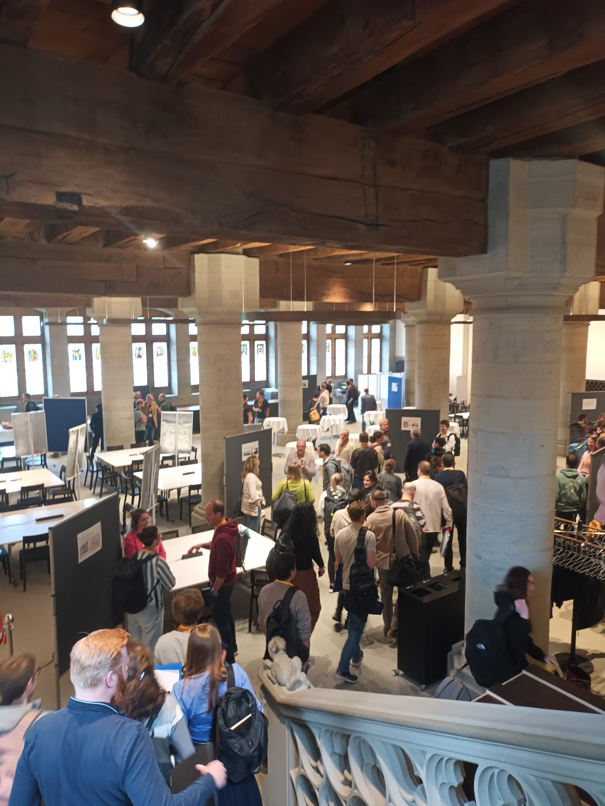
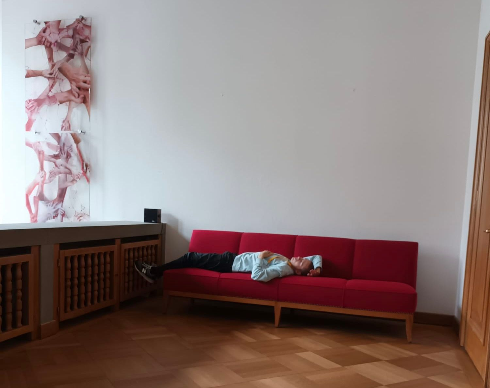
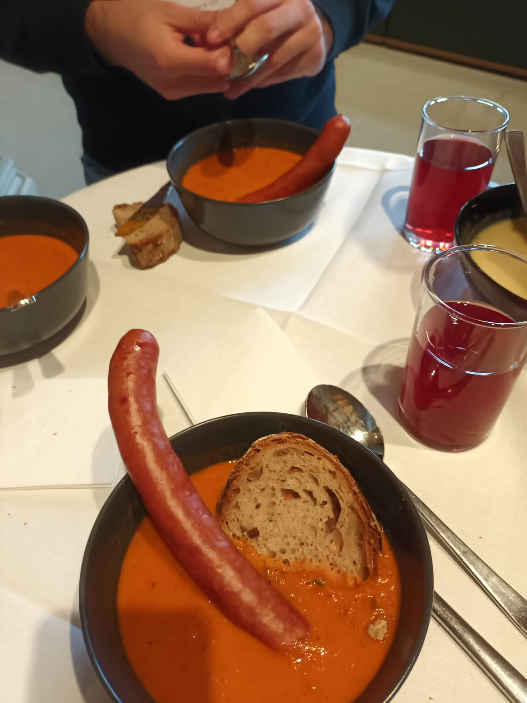
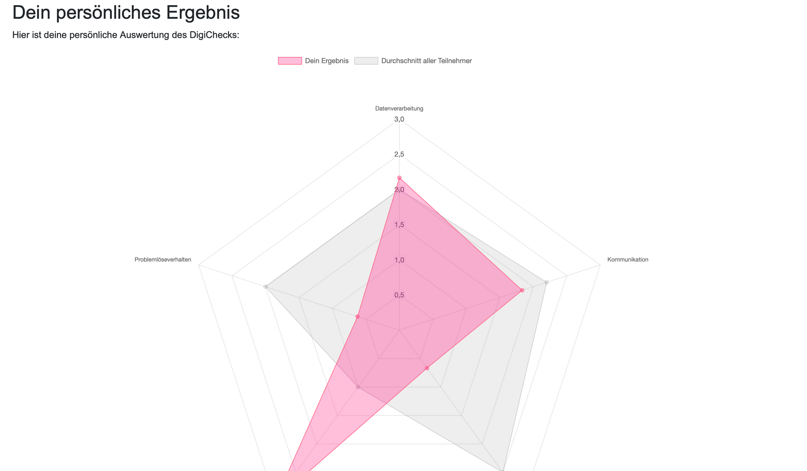
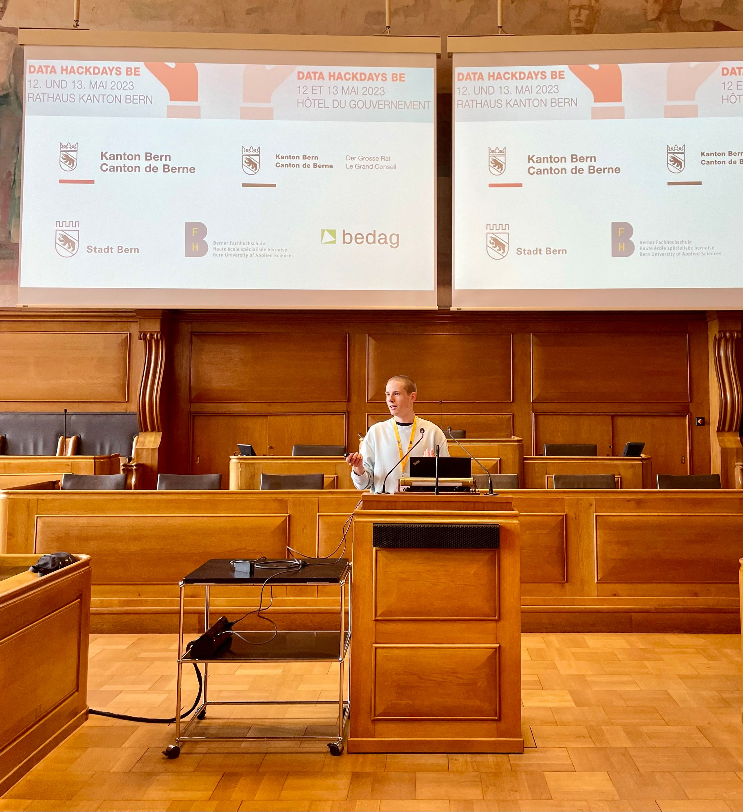
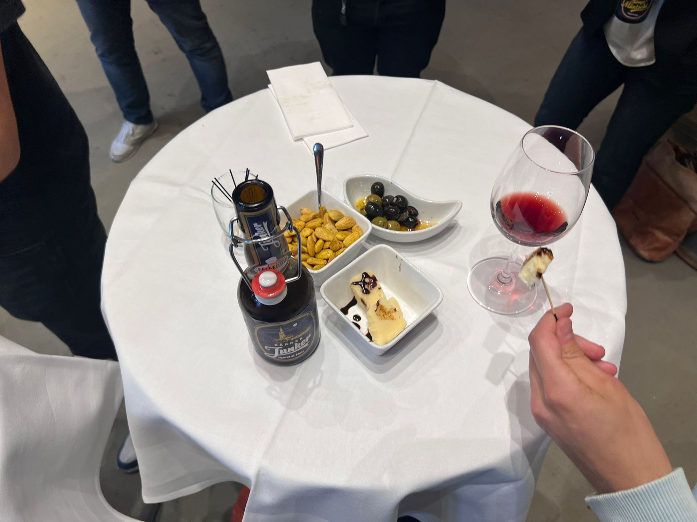
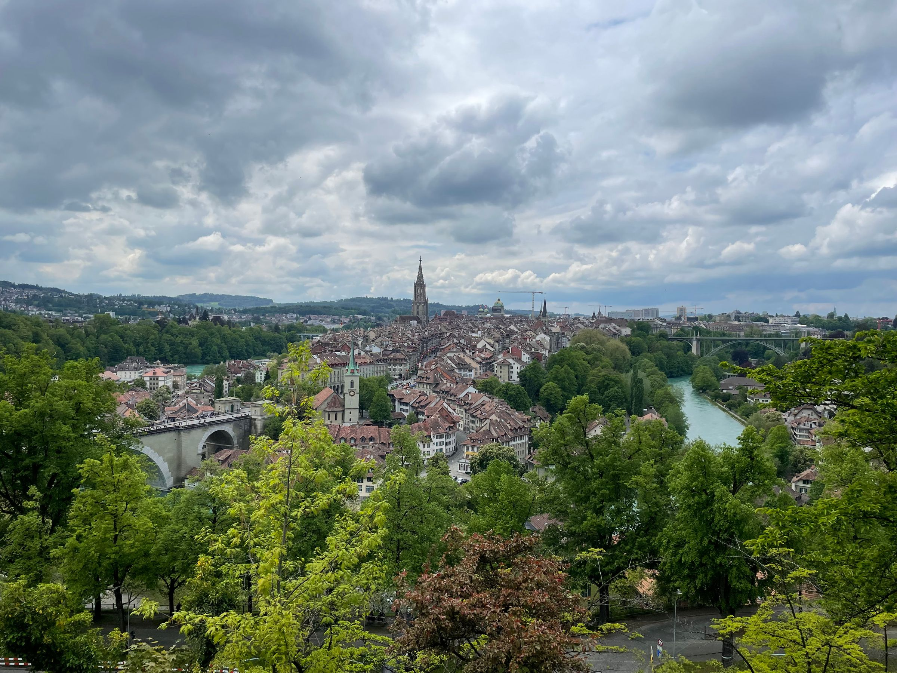

## **Einleitung**

Für das Modul PVD (partizipative Veranstaltungen durchführen) musste ich an einem oder mehreren Veranstaltungen von insgesamt mindestens 36 Stunden teilnehmen. Mit meinen Mitstudierenden habe ich mich auf die Suche nach einem solchen Event gemacht und wir wurden bald fündig. Wir haben uns für die Data Hackdays 2023 in Bern entschieden, da diese an einem geeigneten Datum stattfinden und einige interessante Challenges mit sich brachten, welche man an dem Hackathon absolvieren konnte.

### Was ist ein partizipatives Format?

Eine partizipative Veranstaltung ist ein Event wo die Teilnehmenden aktiv mitmachen können und nicht einfach nur Zuhörende sind. Das Ziel dabei ist es, eine grosse Interaktion zwischen den Teilnehmenden zu schaffen. Bei einem solchen Event kann man sich mit einer Gruppe von verschiedenen Personen mit diversen Hintergründen zusammenarbeiten und von- sowie miteinander lernen.

### Wieso sind die Data Hackdays partizipativ?

Die Data Hackdays sind partizipativ, da man mit Leuten aus der (fast) ganzen Schweiz zusammenkommt, welche alle unterschiedliche Fähigkeiten und Expertisen haben. Man kann sich ein Thema / Projekt aussuchen und ist dann mit neuen Leuten im Team, welche man vorher noch nicht unbedingt kannte. Es gibt an den Data Hackdays keine Vorlesungen oder Monologe, sondern die Teamarbeit steht im Zentrum.

### Was erwarte ich von dem Event?

Ich erwarte von dem Event, dass ich neue interessante Persönlichkeiten kennenlernen werde und mich mit ihnen im Team auseinandersetzen kann. Ebenfalls hoffe ich, dass es interessante Challenges geben wird, in denen ich mein Wissen einbringen kann aber ich gleichzeitig auch von meinem Team lerne. Ich erhoffe mir ein tolles Team und eine kompetitive Stimmung.

## **Motivation**

Ich befinde mich nun im vierten Semester des Data Science Studiums und habe bis heute noch nie an einem Hackathon oder einem ähnlichen Event teilgenommen. Die Erfahrung und die Learnings, welche man so bekommen kann, haben mich aber schon öfters stark gereizt. Als ich dann das Modul PVD kennengelernt habe, war mir klar, dass dies die perfekte Gelegenheit ist, einmal einen Hackathon auszuprobieren und um zu sehen ob mir das überhaupt gefällt und ich dabei viel lernen kann.

## **Hinreise**

Am 12. Mai 2023 um 06:00Uhr verliess ich das Haus und machte mich mit dem Bus und Zug auf den Weg nach Bern. Bereits am Vorabend war ich schon nervös, da ich noch nie an einem Hackathon teilgenommen habe. Die Reise verlief gut und ich traff in Bern drei Freunde vom Studiengang, welche ebenfalls an den Hackdays teilgenommen haben.

## **Tag 1 – Data Hackdays Bern**

*Abbildung 2: Ankunft im Berner Rathaus*

Als wir in Bern angekommen sind konnten wir einen gemütlichen 15 minütigen Spaziergang durch die schöne Altstadt machen, bis wir beim Rathaus ankamen. Ich war sofort überwältigt von der schönen Architektur und der Grösse des Hauses. Wir erhielten Kaffee und Gebäck und durften danach in den Abstimmungssaal, wo uns der Ablauf der Hackdays sowie die einzelnen Projekte vorgestellt wurden. Wir hatten nun die Auswahl zwischen 13 spannenden und vielseitigen Challenges, für welche wir uns frei entscheiden durften. Ich habe mich für das Projekt DigiCheck entschieden.

### DigiCheck und unser Ziel

DigiCheck soll eine Webseite für die Verwaltung des Kanton Berns werden, wo sich die Mitarbeitenden mit Hilfe von einem Fragebogen selbst einschätzen können und anhand ihrer Schwächen passende Lernmaterialien zur Verfügung gestellt bekommen. Zuerst soll also der Mitarbeiter einen Fragebogen ausfüllen. Im Fragebogen gibt es fünf Kompetenzbereiche, (Datenverarbeitung, Kommunikation, Erstellung von Inhalten, Sicherheit & Problemlöseverhalten) bei denen jeweils zwischen 6 und 9 Fragen beantwortet werden müssen. Dabei soll man sich einschätzen zwischen 0 = Ich kenne mich gar nicht aus bis 3 = Ich kenne mich sehr gut damit aus. Danach soll im Hintergrund ein Score anhand der erzielten Punkte berechnet werden. Auf der nächsten Seite soll einem dann ein Spinnendiagramm gezeigt werden, wo man auf einen Blick erkennen kann, in welchen Bereichen man Stark oder eben noch nicht so gut ist. Ebenfalls sollen in den Bereichen, wo man noch Verbesserungspotential hat, 4-5 Links zu geeigneten Lernmaterialien angezeigt werden, mit Hilfe dessen man seinen Score in Zukunft hoffentlich verbessern kann.

### Vorgehen

Wir waren ein Team von 5 Personen, davon zwei von der Fachhochschule Nordwestschweiz und drei Personen von der Fachhochschule Bern, welche alle drei Wirtschaftsinformatik studieren. Leider konnten sich nicht mehr Leute für diese Projekt begeistern, wodurch wir kein sehr diverses Team waren. Unsere Auftraggeberin hat uns kurz die Ziele des Projektes genannt und ist danach wieder verschwunden. Wir durften das Vorgehen und die einzelnen Schritte zum Erreichen des Ziels selbst festlegen. Ich als Data Scientist hatte die Aufgabe, ein paar der Dokumente zu bereinigen in dem ich mit Hilfe von Data Wrangling die uninteressanten Daten aus den Files rauslöschen konnten. Die drei Wirtschaftsinformatiker hatten Erfahrung mit den Programmiersprachen HTML und JavaScript, mit denen Sie die Website erstellen und Designen konnten. Ich hatte meine Tasks bald schon fertig und versuchte die Teammitglieder bei Ihren Arbeiten zu unterstützen. Dies war für mich jedoch ziemlich schwer, da ich keine Ahnung von HTML oder JavaScript habe. Mit Hilfe von ChatGPT versuchte ich allerdings auch ein paar Zeilen Code zu erstellen, diese waren jedoch eher unbrauchbar.

### "Znacht"

Um 19:00 Uhr gab es "Znacht". Wir konnten uns im Rathaus gratis an einem kleinen Buffet bedienen, wo wir Reis mit Hähnchen (Oder Pilzen) erhalten haben. Mein erster Gedanke war aber nicht das Essen, sondern eine Pause! Daher habe ich mich kurz für 10 - 15 Minuten aufs Ohr gehauen.

*Abbildung 3: "Nickerchen"*

Nach dem Abendessen, haben wir nochmals unseren aktuellen Stand angeschaut und der Auftraggeberin präsentiert. Sie war sehr zufrieden und stolz auf unsere Arbeit. Wir haben noch ca. eine Stunde "gehackt" und ein paar Anpassungen an unserem Code vorgenommen. Um 21:30Uhr ging es für mich dann endlich auf direktem Weg nach Hause. Leider ist Bern nicht gerade um die Ecke, weshalb ich rund anderthalb Stunden im Zug verbringen durfte. Zuhause angekommen hat es nicht lange gedauert bis ich totmüde ins Bett fiel und schlief...

... Bis ein paar Studen später um 05:30 Uhr wieder der Wecker klingelte. :/

## ****Tag 2 – Data Hackdays Bern****

Um acht Uhr morgens kam ich am Berner Hauptbahnhof an und machte mich wieder auf den gemütlichen Spaziergang zum Rathaus. Mein Team war ebenfalls schon vor Ort. Wir haben zuerst natürlich den obligatorischen Kaffee zusammen getrunken und ein kurzes Briefing für den Tag abgehalten. Wir mussten nun nur noch ein paar kleine Änderungen am Design der Website vornehmen und dafür sorgen, dass wir die richtigen Links zur Verfügung stellen können, wenn jemand Verbesserungspotential in einer bestimmten Kompetenz hat. Dies haben wir in zwei Stunden gelöst und konnten uns danach an die Präsentation setzten. Danach gab es für alle Teilnehmenden der Hackdays einen "Zmittag".

*Abbildung 4: "Zmittag"*

### Ergebnis

Unser Ergebniss kann sich sehen lassen. Wir konnten den Auftrag für unsere Kundin vollumfänglich erfüllen und haben eine Prototyp Website erstellt. Auf der ersten Seite befindet man sich auf dem Homescreen und kann auf einem Knopf den Test beginnen. Man erhält alle verschiedenen Fragen zur Selbstevaluation und kann, nach dem man diese ausgefüllt hat, die Ergebnisse sehen. Unter der Graphik, von den persönlichen Stärken und Schwächen sieht man nun seinen total Score und erhält zu jedem Kompetenzbereich passende Vorschläge von Links, auf welchen sich passende Lernmaterialien befinden. Ebenfalls haben wir noch eine Seite erstellt, wo man Zugriff auf sein Profil mit allen persönlichen Angaben hat. Diese Seite ist aber im aktuellen Zustand eher ein "Gimmick"

*Abbildung 5: Diagramm der Persönlichen Auswertung*

### Präsentation

Um 15:00 Uhr durften wir unser Projekt und unseren Prototypen vor allen Teilnehmern der Data Hackdays präsentieren. Alle Teams stellten ihre Projekte der Reihe nach vor. Es war sehr spannend zu sehen, was die anderen Teams erarbeitet haben und wie sie vorgegangen sind.

*Abbildung 6: Präsentation*

### Abschluss

Nach den Vorträgen kam noch der Grossratspräsident persönlich auf die Bühne und sagte noch ein paar schöne Worte zum Abschluss und wies auf kommende Events der Data Hackdays hin. Danach gab es noch einen feinen Apero, an dem man sich mit den Teilnehmenden und den Auftraggebenden unterhalten durfte. Dabei habe ich mir nochmals die Zeit genommen um mich bei einem feinen Glas Wein bei der Auftraggeberin von unserem Projekt "DigiCheck" zu bedanken und Kontakte auszutauschen.

*Abbildung 7: Apéro*

## ****Reflexion****

### Wie partizipativ waren die Hackdays?

Die Data Hackdays waren im Grossen und Ganzen sehr partizipativ, da man keine Vorträge oder Vorlesungen hatte, sondern wirklich selbständig, respektive in der Gruppe an dem Projekt arbeiten konnte. Allerdings war es in meinen Augen ein wenig schade, dass in userer Gruppe bereits drei Leute waren, welche sich kannten und das gleiche Studium abschliessen. Daher ist unsere Gruppe nicht so divers, wie ich mir das erhofft hatte.

### Verbesserungsvorschläge

Wenn ich bei der Planung der nächsten Data Hackdays mitwirken könnte, würde ich versuchen die Einteilung der Gruppen so zu gestalten, dass in allen Teams noch diversere Personen zugeteilt sind. Beispielsweise pro Team jemand aus dem Informatik Background, jemand aus dem Sozialen Wesen oder der Juristik und jemand aus dem Kaufmännischen. Klar, dies ist nur ein Wunschdenken und in der Realität sicher schwer umzusetzen. Dennoch denke ich, dass die Einteilung der Gruppen noch Potenzial nach oben hat.

### Was habe ich ganz persönlich bezüglich Partizipation erfahren und gelernt?

Die Teilnahme an den Data Hackdays 2023 war für mich eine neue und spannende Erfahrung. Ich bin froh, dass wir von unserer Fachexpertin Monika Schlatter die Vorgabe erhalten haben, dass wir nicht ein reines Data Science Team machen dürfen super. Ohne diese Vorgabe hätte ich wohl mit meiner üblichen Lerngruppe vom Studium ein Team gemacht und wäre somit nicht aus meiner Komfortzone gekommen. Ich fand es interessant neue Personen kennenzulernen und mit ihnen gemeinsam ein Projekt innert kürzester Zeit zu bestreiten. Dies war für mich persönlich eine grosse Herausforderung, da ich ich sehr schüchtern bin in der Gegenwart von Fremden. Dadurch, dass ich jedoch zwei Tage lang mit diesen Personen im Team gearbeitet habe, konnte ich über meine "Ängste" hinauswachsen und mich in meinen sozialen Fähigkeiten stärken.

## ****Fazit & Schlusswort****

Die Data Hackdays Bern 2023, waren in meinen Augen ein voller Erfolg. Nicht nur als Veranstalltung selbst, sondern durch die Erfahrung, welche ich mitnehmen konnte. Ich hätte nie gedacht, dass man mit viel Durchhaltewillen und Ehrgeiz innerhalb von nur zwei Tagen so viel Erreichen kann. Und dass sogar in einer Gruppe voller fremden Menschen!

Sicherlich werde ich noch lange an die Zeit in Bern zurück denken und stolz sein, auf alles was ich dort mit meinem Team erreichen konnte. Ich denke, dass dies nicht der letzte Hackathon war, an dem ich teilgenommen habe :)
