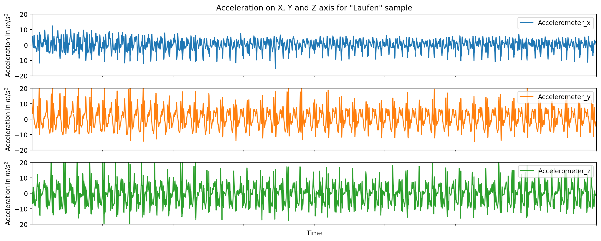
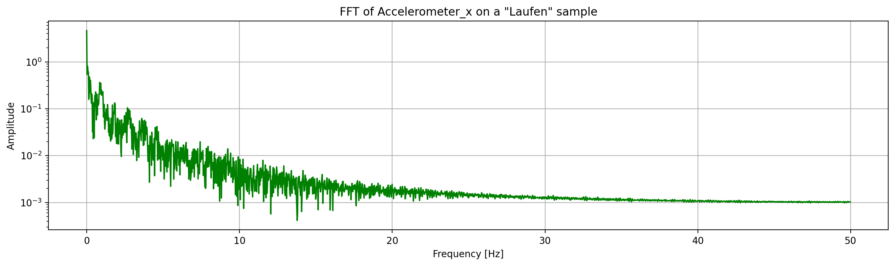
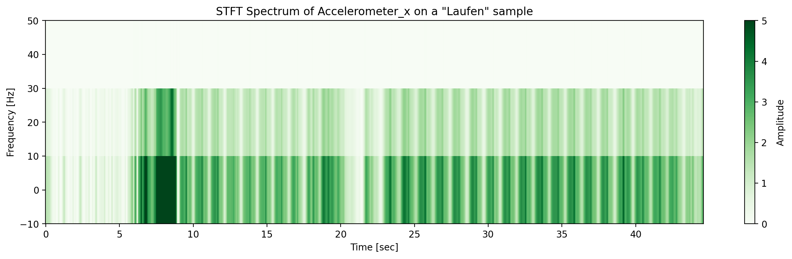
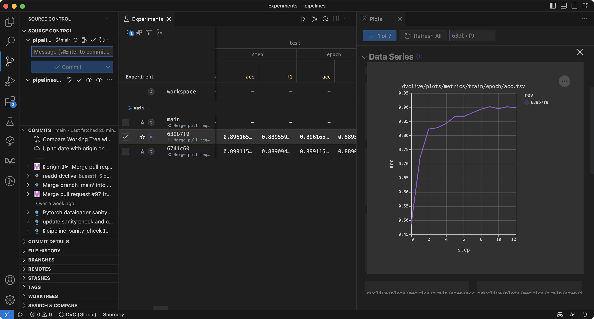
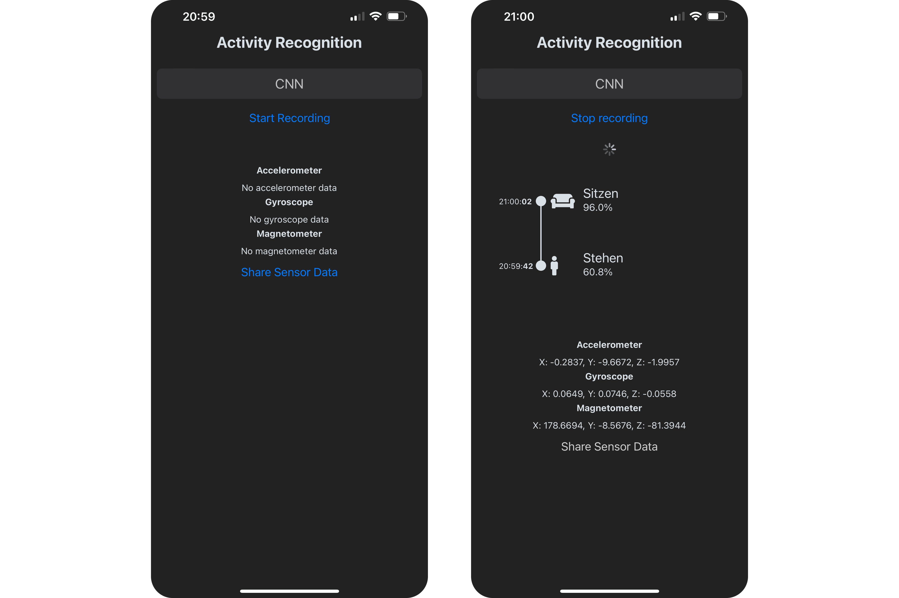

Bewegung spielt eine wichtige Rolle in unserem Alltag und liefert wertvolle Informationen über unsere Gesundheit, Verhaltensweisen und Emotionen. Im Rahmen der Sensor Based Activity Recognition Challenge an der Fachhochschule Nordwestschweiz FHNW haben wir uns das Ziel gesetzt, sechs verschiedene Bewegungsmuster (Gehen (schweizerdeutsch: Laufen), Rennen, Treppensteigen, Velofahren, Stehen und Sitzen) anhand der Analyse von Sensordaten von Smartphones zu identifizieren.

Dabei strebten wir eine Genauigkeit (Test Accuracy & Test F1-Score) von über 95 % an. Eine anspruchsvolle Aufgabe? Sicherlich. Doch basierend auf den Ergebnissen ähnlicher Forschungsarbeiten konnten bereits hohe Testgenauigkeiten erzielt werden.

Smartphones sind mit einer Fülle von Sensoren ausgestattet, darunter Inertialsensoren wie Beschleunigungsmesser, Gyroskope und Orientierungssensoren, sowie Nicht-Inertialsensoren wie Magnetometer, Barometer und GPS. Damit waren sie perfekte Plattform für unser Vorhaben. Die variablen Umgebungsbedingungen wie das spezifische Smartphone-Modell oder der Trageort am Körper stellen dabei nur weitere Puzzleteile in unserem wissenschaftlichen Abenteuer dar.

*Beschleunigungssensor-Werte beim Laufen*

## Die Expedition zur sensorbasierten Aktivitätserkennung

Wie jede Expedition beginnt auch unsere mit der Vorbereitung. Der erste Schritt? Datenerfassung und -aufbereitung. Hierfür verwendeten wir Sensor Logger, eine App, die das Erfassen aller Sensordaten ermöglicht.

Wir legten grossen Wert auf ein konsistentes und homogenes Datenmanagement, um die Daten zuverlässig und konsistent zu etikettieren und zu speichern. Die Datenqualität war stets im Fokus und durch manuelles Zuschneiden und Interpolation konnten wir Unstimmigkeiten ausmerzen. Mit Hilfe von Resampling konnten wir die Datenaufzeichnung verschiedener Geräte und Sensoren auf ein einheitliches Niveau bringen und in gleich lange Sequenzen unterteilen.

Mit dem sicheren Fundament an Daten ging die Reise weiter in die Welt der Datenverarbeitung. Dabei nutzten wir Techniken wie Fast Fourier Transformation (FFT) und Short Time Fourier Transformation (STFT) zur Frequenzextraktion.

*FFT auf dem Accelerometer (x-Achse)*

*STFT Spektrum auf dem Accelerometer (x-Achse)*

Unsere Arbeit resultierte in der Entwicklung zweier Modelle zur Aktivitätserkennung: Ein traditionelles Machine Learning Modell (Histogram Gradient Boosting Classifier), welches auf die FFT Daten zugreift und ein Deep Learning Modell (Convolutional Neural Network), welches die STFT Daten nutzt.

Beide Modelle haben ihre Schwächen und Stärken und wir zogen einen grossen Nutzen daraus, diese beiden Ansätze auszubalancieren und optimal zu kombinieren. Dabei war die MLOps Plattform DVC ein wertvolles Werkzeug, um unsere Modelle und unsere Pipeline zu überwachen, zu verwalten und zu optimieren.

*DVC Umgebung auf Visual Studio Code*

## Die sinfonische Verbindung von Sensorik und Machine Learning

Unsere Modelle durchleuchteten die Fülle an Sensordaten, wodurch verschiedene Aktivitäten identifiziert werden konnten. Decision Matrizen kamen uns dabei zur Hilfe, um Fehler und Biases der Modelle klassenbasiert aufzudecken. Die Leistungsfähigkeit unserer Modelle zeigte sich in den Metriken. Durch die kontinuierliche Optimierung konnten wir mit unserem Histogram Gradient Boosting Classifier Modell eine Genauigkeit von 98.5 % erreichen. Es ist uns somit gelungen, unser Ziel sogar noch zu übertreffen.

Der nächste Schritt bestand dann darin, unsere Modelle in eine praktisch anwendbare Form zu bringen. Wir verpackten unsere Modelle in eine Django API und stellten sie über eine REST-Schnittstelle zur Verfügung.

Diese Schnittstelle dient als Rückgrat für unsere neu entwickelte Applikation. Mit dieser App können Benutzer eine Messung starten und stoppen. Nach Abschluss der Messung visualisiert die App die vorhergesagten Bewegungsprofile in einer übersichtlichen Timeline.

*Unsere App vor und während der Aufnahme*

## Schlusswort

Die Sensor Based Activity Recognition Challenge hat uns nicht nur die vielfältigen Möglichkeiten der Verbindung von Sensorik und Machine Learning aufgezeigt, sondern auch die Bedeutung einer kritischen Betrachtung der eingesetzten Modelle. Wir konnten beeindruckende Ergebnisse mit simplen Algorithmen erzielen, was die Notwendigkeit unterstreicht, auch herkömmliche Machine Learning Modelle in Betracht zu ziehen, anstatt direkt auf Deep Learning zu setzen. Unsere erreichte Genauigkeit von 98.5 % mit dem Histogram Gradient Boosting Classifier bestätigt dies.

Es war eine spannende Reise und wir freuen uns darauf, neue Fragestellungen bearbeiten zu können.
