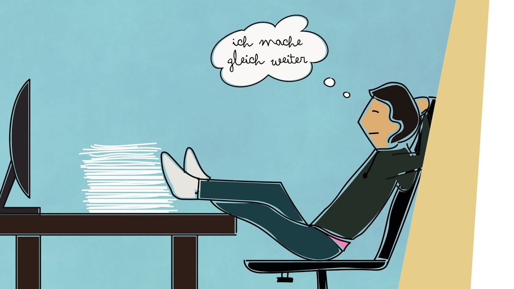
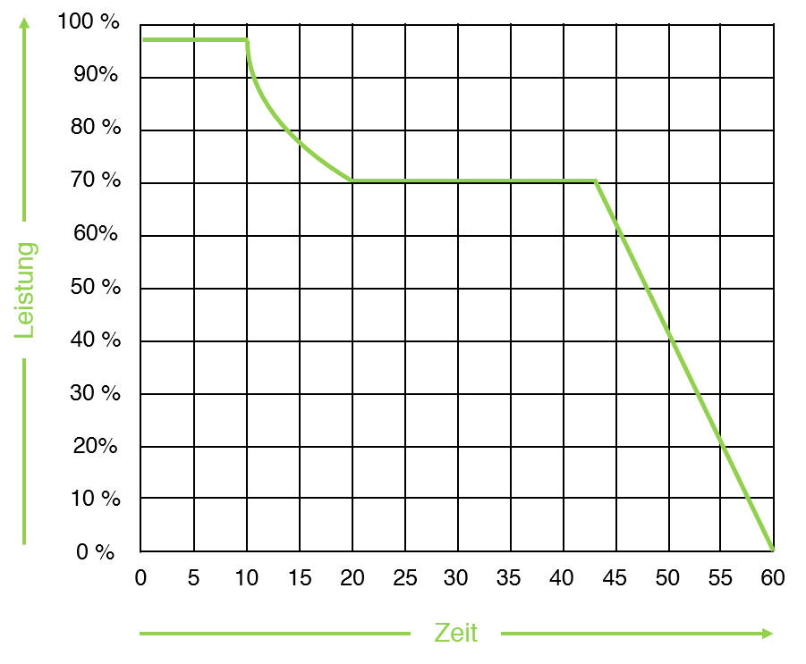

Ein Blog von Alexander Schilling, Bachelor Student in Data Science an der Fachhochschule Nordwestschweiz.

Hast du dir auch einmal vorgenommen, etwas zu machen und hast es schlussendlich doch aufgeschoben? Das nennt man Prokrastination und daran leiden sehr viele StudentInnen. Zudem sind Ablenkungen und fehlende Motivation zu lernen auch zwei grosse Themen, die StudentInnen daran hindern, effizient zu lernen.

Da ich auch unter diesen Lernhindernissen leide, war es für mich wichtig, diese zu überwinden um ein erfolgreiches Studium zu haben.

Ihr werdet in diesem Blog erfahren, wie ich mich mit diesen Themen auseinandersetzte und welche Erfahrungen ich dabei sammelte. Ihr erfahrt unter anderem auch, welche Strategien und Lernhacks angewandt wurden und ich hoffe euch dabei zu inspirieren, diese auch zu probieren.

Zu Beginn dieses Experimentes habe ich meine grundlegenden Lernhindernisse notiert, dann versucht die genauen Auslöser dafür herauszufinden.

## Ablenkung

Zu Beginn meines ertsen Semesters blieb ich öfters zuhause. Ich bemerkte aber schnell, dass dies problematisch war, da ich schlicht zu wenig arbeitete und schnell in Rückstand geriet.

Die Ablenkung war für mich das grösste Problem, da ich sehr oft von meinem Handy oder sonstigen elektronischen Geräten abgelenkt wurde. Beim Arbeiten oder Lernen hatte ich das Handy immer gereade nebenan oder ich hatte ablenkende Webseiten wie Discord oder Youtube im Browser offen. Ein weiterer Grund für meine Ablenkungen war, zuhause zu arbeiten, weil ich schnell durch verschiedene Sachen abgelenkt wurde. Unteranderem von meinem Bett, dem TV oder vor allem im Sommer, von der Lounge im Garten. Durch diese Ablenkungen konnte ich lange und effektive Konzentrationsphasen nicht einhalten.

Zum Thema Handy gab es eine offensichtliche Methode: Das Gerät vom Arbeitsplatz zu entfernen und komplett stumm zu schalten. Ich erlaubte es mir nur dann auf mein Handy zu gehen , wenn ich gerade Pause mache. Aber sobald die Pause beendet ist, lege ich das Handy wieder weg vom Arbeitsplatz.

Da sich wie oben erwähnt in meinem Zimmer einige Ablenkungsfaktoren befinden, versetzte ich mich bei fehlender Konzentration ins Wohnzimmer und arbeitete dort.

## Prokrastination

In der Vergangenheit habe ich öfters wichtige Aufträge aufgeschoben und diese erst im letzten Moment unter Zeitdruck abgeschlossen. Klar gibt es Menschen, die besser unter Zeitdruck arbeiten können. Aber wie schön wäre es, ein Projekt ohne Stress abgeben zu können oder sehr vorbereitet an eine Prüfung zu gehen? Klingt zu gut um wahr zu sein, oder?

Nein, um die Prokrastination einzudämmen ist schlicht eine strukturierte und ordentliche Planung nötig, und etwas Selbstdisziplin 😉

Dies habe ich durch ein gut strukturiertes Zeitmanagement versucht. Zuerst erstellte ich einen Semesterplan in Excel. Dieser beinhaltete alle Schulwochen inklusive wichtige Termine wie Prüfungen oder Deadlines für Abgaben. Somit entstand ein guter Übersicht über das ganze Semester hinüber. Dieser Semesterplan ist der Grundstein für die darauf folgende Tages – und Wochenplanung.

Anhand des Semesterplans und was in der kommenden Woche ansteht, setzte ich jeden Sonntagabend kleinere Ziele für die kommende Woche wie z.B. “Löse Aufgabe 1-3 in Wahrscheinlichkeitsrechnen”. Es ist aber wichtig diese Planung grob zu halten, weil es unmöglich ist, eine ganze Woche gut planen zu können.

Nachdem die Wochenplanung erstellt wurde, war mir klar, welche Aufgaben zu tun waren. Dadurch konnte ich sehr einfach jeden Abend ein Zeitplan für den nächsten Tag verwalten. Was hier zu bedenken ist; Pausen einplanen. Dazu werde ich im Bereich fehlende Motivation noch zusätzliche Inputs geben.

Die nächste Aufgabe war es, mich an dieses Zeitplan zu halten.

## Fehlende Motivation

Fehlende Motivation fürs Lernen war für mich auch ein grosses Hinderniss. Es fiel mir öfters schwer eine Aufgabe zu beginnen. Noch schlimmer war es diese begonnene Aufgabe fertig zu machen, da ich am Anfang dieses Experiments einfach nicht wusste, wie ich korrekt lernen muss, also was für mich funktionierte.

Mir half es sehr in die Schule zu gehen, da ich dort generell effizienter arbeiten konnte als von zuhause aus. Am Campus konnte ich meine Mitstudierenden näher kennen lernen, miteinander Aufgaben lösen und Wissen austauschen. Schlussendlich war für mich der “Vibe” in der Schule sehr geeignet, erfolgreich zu lernen. Wenn ich andere StudentInnen arbeiten sehe, passe ich mich an dieser Umgebung an und lerne demendsprechend auch. Zudem ist einfach die Lernumgebung in der Schule optimal und bietet vierschiedene Möglichkeiten an; Viele offene Flächen, Lernshuttles, saubere Tische, coole Technologien wie das elektronische Flipchart, mietbare Räume usw. Zuhause alleine und im zum Teil dreckigen Zimmer voller Ablenkungen hat man diesen Luxus nicht.

Falls ihr nicht zur Schule kommen könnt, schaut dass euer Lernumgebung zuhause sauber gestaltet ist. Also räumt den Bürotisch jeden Abend vor dem Einschlafen, damit ihr am Morgen nicht aufräumen müsst. Wer will schon früh am Morgen auf einem unsauberen Tisch arbeiten? Genau, niemand. Es muss nicht 100% sauber sein, 2 Minuten Aufwand reichen schon.

**Was hält die Motivation sonst noch hoch?**

**Wenn man seinen eigenen Fortschritt sehen kann!!**

Anfangs war ich skeptisch, ein Lerntagebuch zu führen, aber was ist ein Experiment, ohne etwas Neues auszuprobieren und Erfahrungen zu sammeln? Das Führen des Tagebuchs fiel mir erstaunlich positiv auf. Ich notierte, was ich in dieser Woche gemacht und gelernt habe, ob ich irgendwo in Schwierigkeiten geraten bin, was ich dagegen gemacht habe und was ich nächstes Mal besser machen möchte. Wichtige Erfahrungen mit Lerninhalten, mit meinem Lernumfeld und mit mir als Person wurden notiert. Z.B: “Ich habe mich weniger durch mein Handy ablenken lassen, weil ich diese Methoden befolgt habe und ich war motivierter mit anderen zu arbeiten statt alleine.” Ich konnte dadurch auf die vergangene Woche zurückblicken und konnte schnell sehen, ob diese erfolgreich war oder ob ich etwas an meinem Lernstil ändern musste.

Falls ihr eure Motivation erhöhen wollt, dann lädt hier die Vorlage runter: [Lerntagebuch Vorlage](https://web.archive.org/web/20170423094306/https://www.widulle.ch/images/dokumente/handlungsorientiert_lernen/lws5.5-lerntagebuch-komplett.pdf) *(Hinweis: Ihr müsst das Lerntagebuch für mindestens 4 Wochen führen, sonst könnte es zu falschen Entscheidungen kommen.)*

Man verliert oft die Motivation, wenn es bei einer Aufgabe wirklich nicht weitergeht. Bei mir war das sehr oft so und ich wusste zu Beginn dieses Experiments nicht, was ich dagegen machen könnte. Die Antwort dazu ist sehr simpel: **Pause machen!**

Wie im Bild rechts zu sehen, sinkt die Leistung sehr schnell nach 42 Minuten. Zudem sinkt sie auch wenn man bei einer Aufgabe nicht weiterkommt.

Ich unterschätzte Pausen und habe immer versucht das Problem zu lösen und erst dann eine Pause zu machen. Dies ist aber falsch. Heutzutage gehe ich ans frische Luft und esse und trinke etwas kleines, um den Kopf zu leeren. Einmal war ich wirklich mehrere Stunden an einer Aufgabe dran und kam überhaupt nicht vorwärts. Danach ging ich ins Mittagessen und keine fünf Minuten später fiel mir die Lösung ein.

Zurück zum Teil Prokrastination; Tragt Pausen in euer Tagesplan ein und unterschätzt sie nicht, wenn ihr nicht mehr vorwärts kommt. Es ist kein Problem das Tagesplan nicht ganz genau zu befolgen.

Schaut euch hierzu die [Pomodoro-Technik](https://de.wikipedia.org/wiki/Pomodoro-Technik) an.

## Schlusswort

Ich bin nicht perfekt und halte mich nicht immer an meine Pläne und Aufträge. Aber durch dieses Experiment erfuhr ich welche Lernhacks und Strategien für mich funktionieren und ich fand es interessant verschiedene Methoden zu versuchen.

Wichtig zu bedenken ist, deine Lernstrategien zur Gewohnheit zu machen. Wenn euer Lernen eine Routine wird, dann habt ihr gewonnen. Aber dies kommt nur mit Übung und Disziplin.

Ich hoffe ich konnte euch inspirieren, einige meiner Methoden für euch selber auszuprobieren!

## Quellen

Pomodoro-Technik: https://de.wikipedia.org/wiki/Pomodoro-Technik

Abbildung 1: [https://www.orizon.de/uploads/media/content-desktop/08/1848-digitale-ablenkungen-am-arbeitsplatz.webp?v=2-0](https://www.orizon.de/uploads/media/content-desktop/08/1848-digitale-ablenkungen-am-arbeitsplatz.webp?v=2-0)

Abbildung 2: [https://www.youtube.com/watch?v=arcNclA7FUs](https://www.youtube.com/watch?v=arcNclA7FUs)

Abbildung 3: https://anchukoegl.com/keine-motivation/

Abbildung 4: https://www.studienscheiss.de/durchlernen-pause-arbeitsrhythmus/

Abbildung 5: https://www.learningsnacks.de/share/9153
