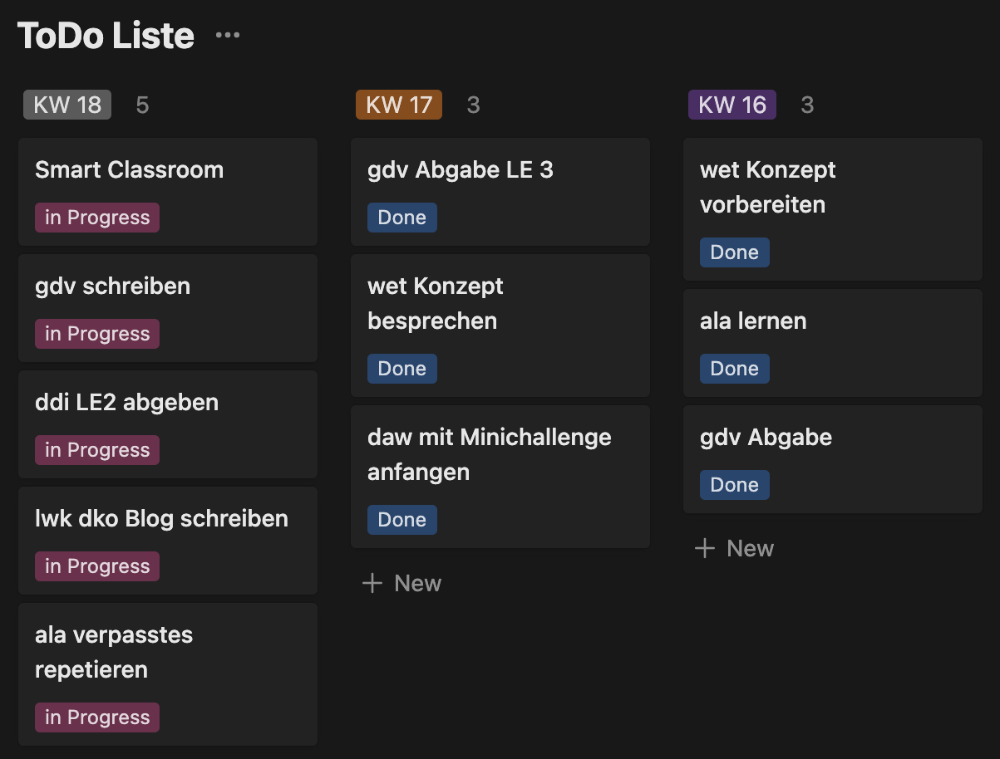
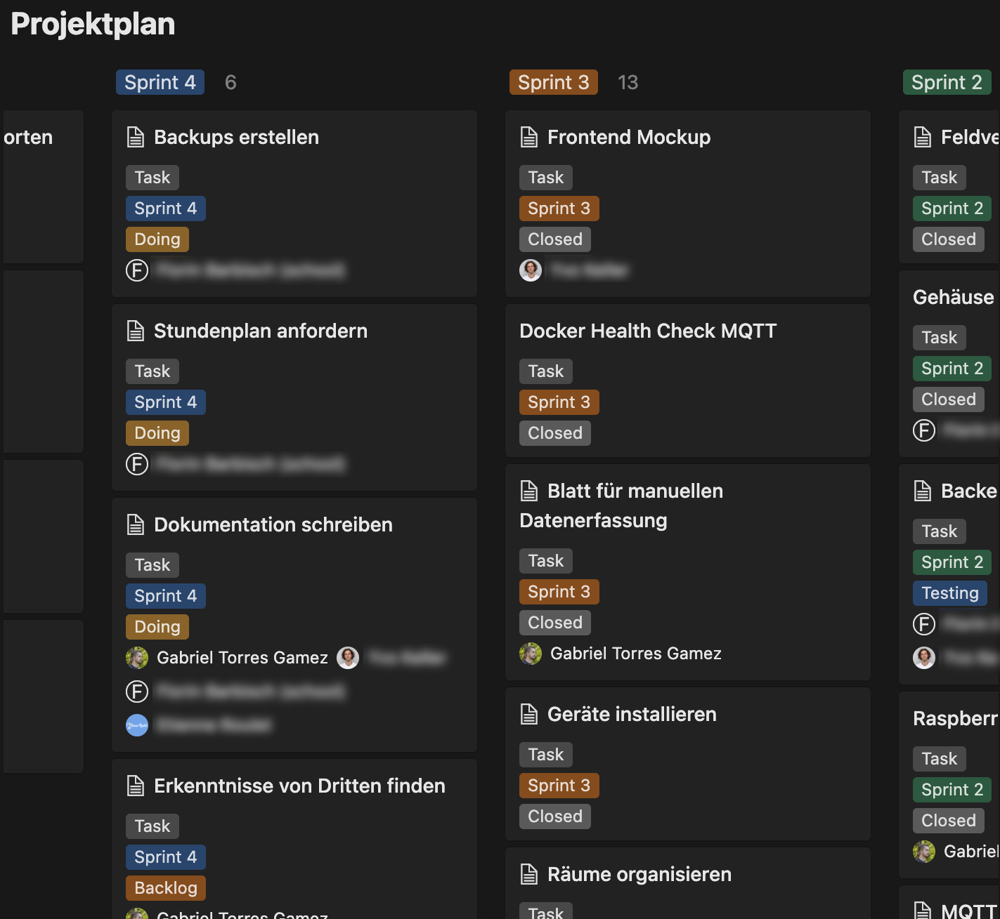
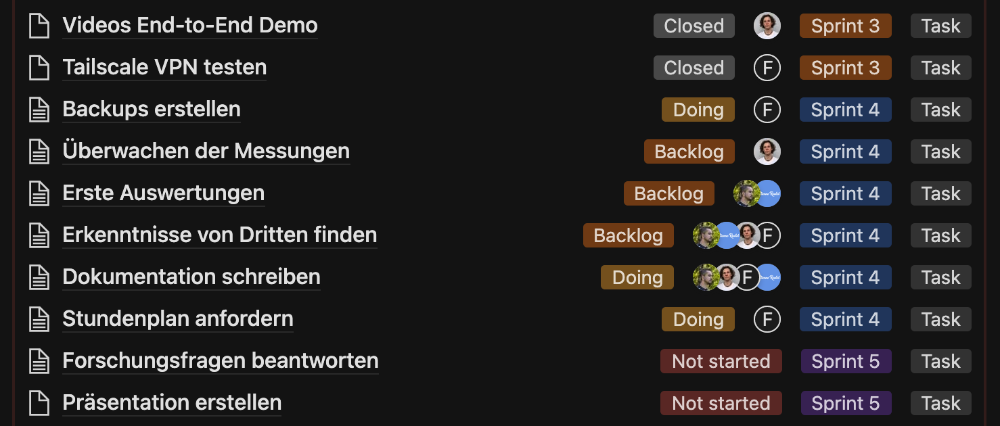
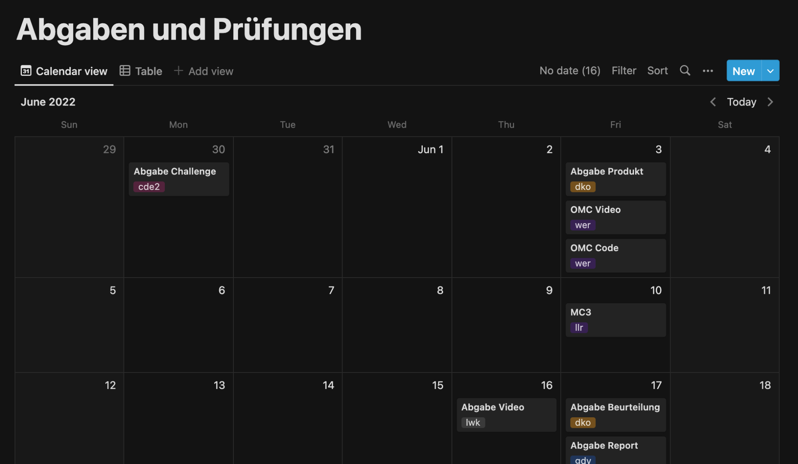
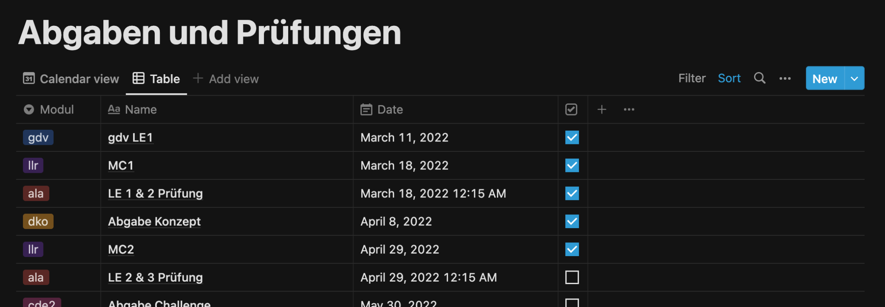
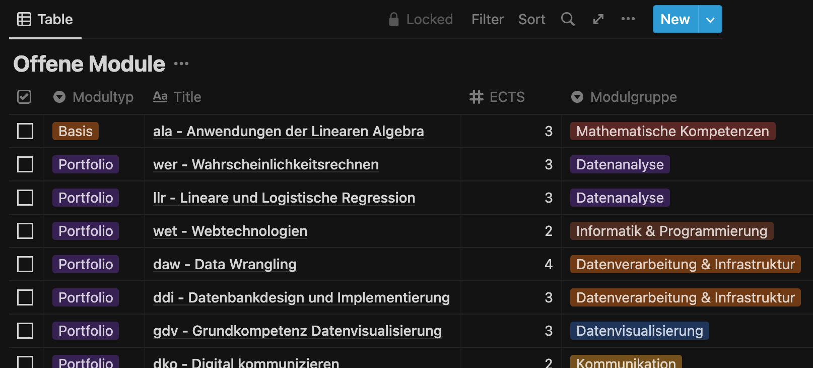
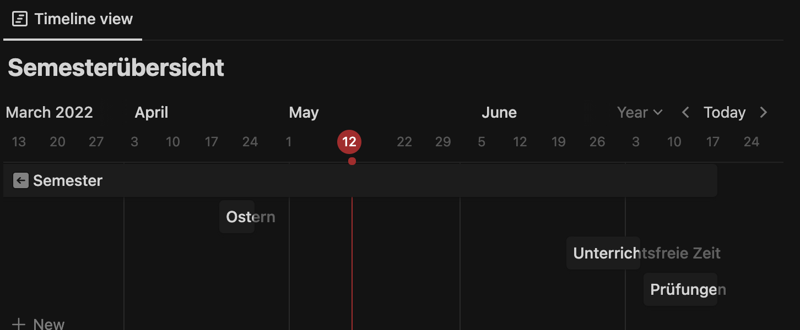
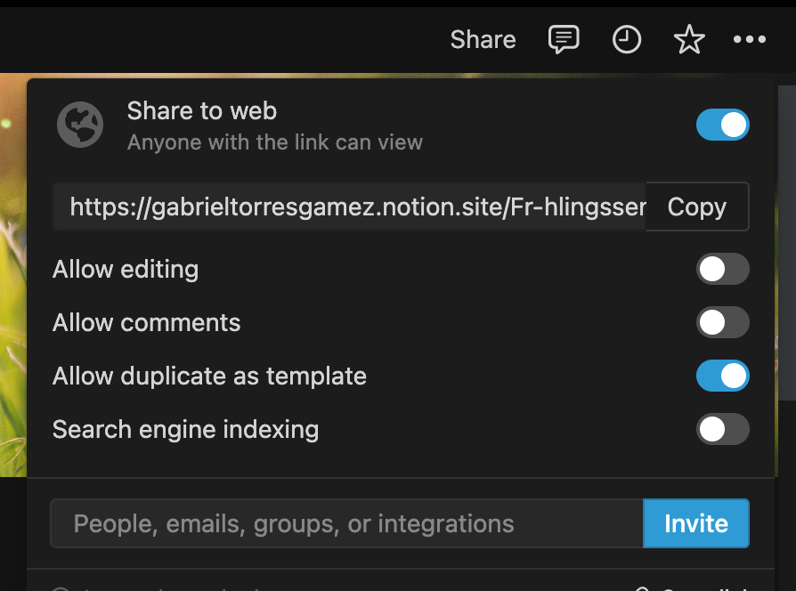

Diese Situation mag vielen bekannt sein: Man ist im ersten Studiumssemester und fühlt sich von allen Terminen und Abgaben überwältigt. Vieles muss selbstständig erlernt werden, was öfters in Prokrastination enden kann. Was dagegen helfen kann, ist eine gute Planung. Ich musste mir das im ersten Semester meines Studiums selbst eingestehen, da ich es mir von der Berufsmatura und der Berufsschule angewöhnt hatte, nur wenig zu lernen und alles auf den letzten Drücker zu machen.

In diesem Blogbeitrag berichte ich, wie ich Notion ([https://www.notion.so](https://www.notion.so)) zur Planung meines Studiums verwende und was mir die Funktionalitäten des Tools für einen Mehrwert geben.

## Was ist ein “Notion”?!?

Notion ist prinzipiell eine Notizsoftware, ABER: Notion kann für viel mehr verwendet werden als nur um Notizen zu machen. Diese App kann so stark angepasst werden, dass es sogar als Projektmanagementtool dienen kann. Das ist auch das Ziel von Notion: Das Tool soll je nach Anwendungsfall angepasst werden können.

Ich konnte bereits mehrere Projekte vollständig mit Notion planen und managen. Man kann sich Anhand mehrerer simplen aber erweiterbaren Funktionen komplexe Systeme aufbauen. Eines davon sind Board Views, welche ich im nächsten Kapitel anhand ToDo Listen und Taskboards erklären werde.

## ToDo Listen

Um immer den Durchblick zu haben, wo man gerade steht und was es noch zu tun gibt, bietet es sich an, eine ToDo Liste zu erstellen. Das Konzept einer ToDo Liste ich recht simpel, kann aber im Notion mit wenigen Tricks effizient erweitert werden:

In meinem Fall habe ich eine ToDo Liste die ich in Kalenderwochen kategorisiere. In dieser Liste erfasse ich durchgehend Tasks, die ich gerne bis Ende Woche erledigt haben will. Das hilft mir vorallem wenn mir langweilig ist oder ich nicht mehr weiss was noch alles zu erledigen ist. Die Liste dient mir deshalb meistens als Reminder. Die Unterteilung in Kalenderwochen ermöglicht es mir züsätzlich, vergangene Tasks wieder aufzurufen oder eine Woche bereits im Voraus zu planen. Gleichzeitig ist die Liste somit aufgeordnet und visuell ansprechend. Bereits vergangene Wochen können auch leicht archiviert werden.

*Abbildung 1: Notion ToDo Liste*

Um diese ToDo Liste zu erstellen habe ich eine Board-View Datenbank hinzugefügt. Danach kann man noch Labels hinzufügen und hat bereits eine funktionsfähige ToDo Liste die man je nach belieben anpassen kann. Man kann beliebig viele Labels hinzufügen und sogar andere Personen markieren. Dies lohnt sich vorallem bei Projekten, wie ich im nächsten Unterkapitel erläutern werde.

### Alternative zu Trello

Board-View Datenbanken können auch für andere Sachen als nur ToDo Listen verwendet werden. Für Projekte nutze ich diese Datenbank gerne als Trello ([https://trello.com](https://trello.com)) Alternative.

Dafür kann man wie oben eine To-Do Liste erstellen, aber anstatt sie mit der Kalenderwoche zu kategorisieren, kategorisieren wir sie in Sprints. Die einzelnen Karten sind zugleich Unterseiten, das bedeutet, dass wir jeweils in den Karten Informationen zum spezifischen Arbeitspaket erfassen können. Wir können zusätzlich Labels hinzufügen, um zu sagen ob es ein Task oder ein Epic ist und den Zustand (Backlog, Doing, Postponed, Closed, etc.) des Tasks spezifizieren. Man kann auch die Tasks einem oder mehreren Usern zuweisen um die verantwortliche Person des Tasks jederzeit sichtbar zu machen. Das einzig limitierende ist die eigene Vorstellungskraft.

*Abbildung 2: Notion Board View für Projekte*

Ein weiterer Vorteil an der Notion Variante ist, dass man auch andere Views hinzufügen kann. Zum Beispiel kann man ein List View zur gleichen Datenbank erstellen, damit man die Tasks kompakter als Liste ansehen und sortieren kann.

*Abbildung 3: List View von Abbildung 2*

Ich konnte Notion schon in mehreren Projektenplanungen verwenden und bin bis jetzt noch nie auf Probleme gestossen. Sogar ganz im Gegenteil: Es hat meinen Gruppen einige Sachen erleichtert und eine Möglichkeit geboten, unsere Dokumentation, unsere Planung und unser Wissensmanagement an einem Wort abzuspeichern.

## Kalender

Notion Datenbanken haben noch weitere Funktionen. Anhand Calendar-Views kann man sich einen Kalender zusammenbasteln. Diesen Kalender nutze ich, um Deadlines und Prüfungen einzutragen. Somit muss ich nur anfangs Semester alle Termine eintragen und dann immer einen Überblick über was noch auf langfristiger Sicht zu tun ist. Ein regelmässiger Blick auf diesen Kalender hilft mir auch sicher zu sein, dass alles rechtzeitig abgegeben wurde oder noch abgegeben werden muss.

*Abbildung 4: Notion Kalender*

Falls man die Kalenderansicht nicht mag, kann man auch ein Table-View hinzufügen. Man kann nach belieben zwischen den beiden Ansichten wechseln. Ich finde, dass bei einem Table-View die Einträge kompakter und übersichtlicher aufgelistet sind und es mir so leichter fällt neue Einträge zu erfassen. Jedoch finde ich dass sich die Kalenderansicht für die Abschätzung der noch verbleibenden Zeit besser lohnt.

*Abbildung 5: Table View vom Kalender in Abbildung 4*

## Tabellen

Wenn wir schon beim Thema Table View sind: Tabellen können auch genutzt werden, um eine Übersicht der noch offenen Module zu erstellen. Diese Übersicht dient vor allem in der Einschreibungsphase als Orientation und kann mit anderen leicht durch die “Share” Option mit Mitstudierenden geteilt werden. Notion bietet zudem auch wie in Microsoft Excel mathematische Operationen wie das Summieren einzelner Spalten an. Somit kann man gerade sehen, für wieviel ECTS man sich einschreibt/eingeschrieben ist.

*Abbildung 6: Notion Tabelle*

Anhand dieser Tabelle konnte ich immer Problemlos meine Modulliste mit anderen Mitstudenten abgleichen und schauen, dass ich mich nicht für zu viele oder zu wenige Module einschreibe.

## Timelines

Man kann im Notion auch Timelines verwenden, um einen Zeitstrahl zu generieren. Diese Funktion kann zur Ferien- und Semesterwochenplanung dienen. Man kann die Timeline auch bei der Zeitplanung in Projekten nutzen. Jedoch finde ich, dass man da für Projekte basierend auf das Wasserfallmodell lieber zu ausgereiften Alternativen greifen soll.

*Abbildung 7: Notion Timelines*

Die von mir erstelle Semesterübersicht half mir zu schauen, wieviel Zeit ich noch im Semester übrig hatte und zu wissen, wie viel Wochen Unterricht noch vor mir stehen.

## Kollaboration

Jetzt noch zu meinem lieblings Key-Feature: Notion bietet verschiedene Optionen an, um zu kollaborieren. Man kann über den Share Button die Seite per Link teilen oder per E-Mail Adresse Kollaboratoren hinzufügen. Man kann auch bestimmen, was für Zugriffsrechte diese Kollaboratoren haben. Das ermöglicht Notion als Projektmanagement Software zu dienen. Notion kann so auch als Organisationsdokumentation dienen, auf die alle Mitarbeiter einer Firma oder Organisation zugreifen können. Die Kollaborationsfunktionalität bietet sich vorallem auch für Peer-Reviews von Abgaben als Vorteil an, da Änderungen in real-time übernommen werden.

*Abbildung 8: Sharing Funktion von Notion*

## Vorlage

Da man Anhand von Screenshots nur schlecht einen Einblick in die verwendete Struktur bekommt, habe ich für euch ein kleines Notion Template vorbereitet, welches man in den eigenen Workspace kopieren kann. Das Template soll dazu dienen, erste Erfahrungen mit Notion zu sammeln und Inspiration für die eigene Planung zu sammeln.

[https://gabrieltorresgamez.notion.site/](https://gabrieltorresgamez.notion.site/Vorlage-Semesterplanung-cb953f69d2e04d8abdebe0835202ac19)

## Fazit

Mit den bereitgestellten Funktionen von Notion kann man sehr leicht eine eigene Lernstruktur erstellen. Diese muss aber nicht gerade wie meine aufgebaut sein, sondern soll im besten Fall personalisiert sein. Man soll schlussendlich selbst einschätzen können, was gut hilft und was eher weniger.

Ich verwende Notion schon seit Studiumsbeginn und kann nur positiv darüber berichten. Das Tool hilft mir, Abgaben und Prüfungstermine im Überblick zu behalten und einzuteilen, kurz- und langfristige Planungen effizient zu gestalten und Projekte gezielt anzugehen. Das Tool kann ich nur weiterempfehlen!
